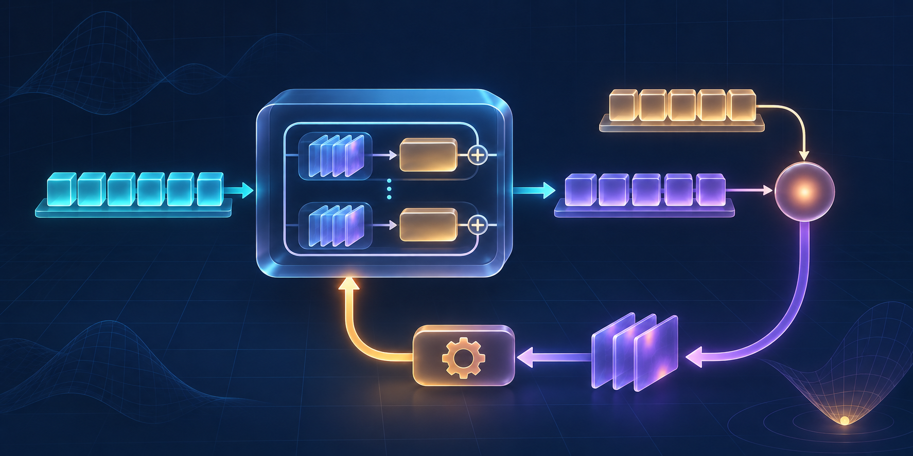
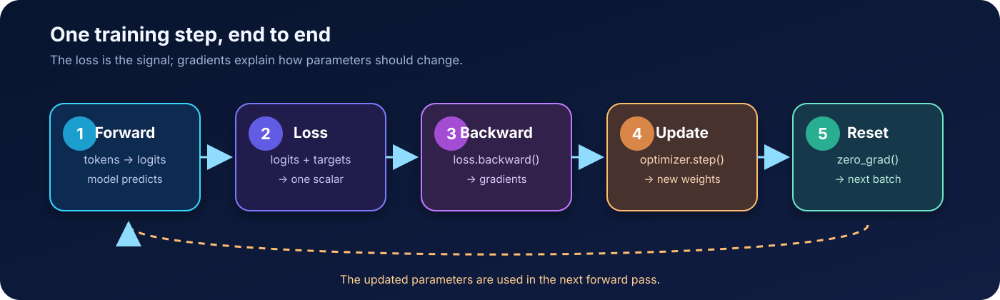
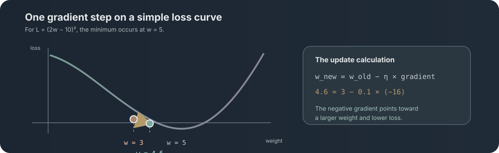
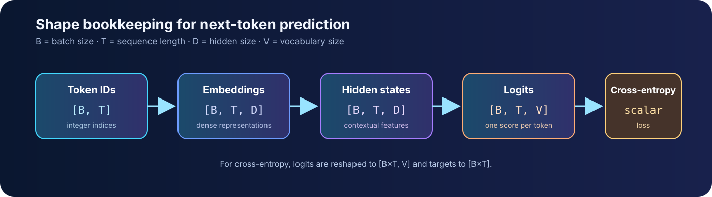
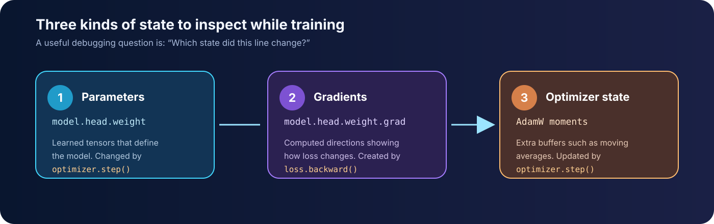
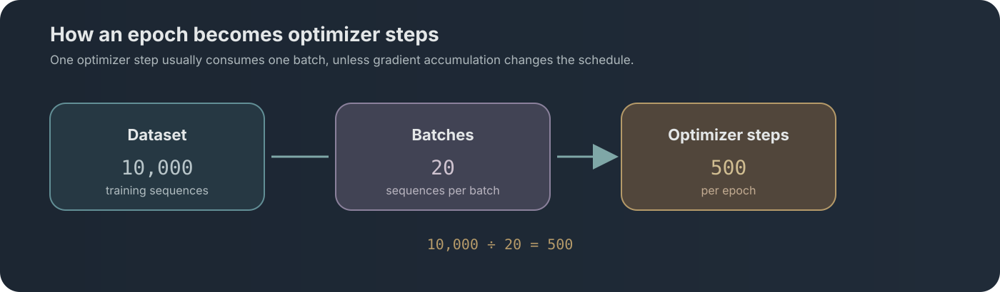

# Module 01 — Anatomy of One LLM Training Step

**LLM Training Engineering · Training fundamentals**



> **The central idea:** training is a controlled loop that measures prediction error, computes how each parameter contributed to that error, and then changes the parameters by a small amount.

In a DeepSeek-from-scratch project, you may build components such as attention, MLA, MoE layers, and optimizers. This chapter zooms in on the event that makes all of those components learn:

> **What exactly happens during one training step, and how can we tell whether it worked?**

By the end, you will be able to:

1. Trace a complete training step from input tokens to updated weights.
2. Explain the relationship between parameters, gradients, and optimizer state.
3. Use `loss.backward()`, `optimizer.step()`, and `optimizer.zero_grad()` correctly.
4. Inspect parameters and gradients before and after an update.
5. Write and debug a small causal language-model training loop.

The runnable version of the experiments is in [`notebooks/01-anatomy-of-llm-training.ipynb`](../notebooks/01-anatomy-of-llm-training.ipynb).

## 1. The complete training lifecycle

Imagine training a language model to predict the next token. Given the input sequence:

```text
The  →  cat  →  sat  →  on
```

the targets are shifted one position to the left:

```text
cat  →  sat  →  on  →  mat
```

The model produces a probability distribution over the vocabulary at every input position. A training step then follows five stages:



1. **Forward pass** — run the model and produce prediction logits.
2. **Loss calculation** — compare those logits with the target token IDs.
3. **Backward pass** — compute a gradient for every trainable parameter.
4. **Optimizer step** — use the gradients to update the parameters.
5. **Gradient reset** — clear the old gradient buffers before the next step.

The most important distinction is this:

> `loss.backward()` computes gradients. It does not update the model weights. `optimizer.step()` performs the update.

## 2. A one-parameter numerical example

Before looking at a Transformer, consider a model with one trainable parameter:

$$
\hat{y} = wx
$$

Suppose:

| Quantity | Value |
| --- | ---: |
| Input, $x$ | 2 |
| Correct answer, $y$ | 10 |
| Initial weight, $w$ | 3 |
| Learning rate, $\eta$ | 0.1 |

The prediction is:

$$
\hat{y} = 3 \times 2 = 6
$$

Using squared-error loss:

$$
L = (\hat{y} - y)^2 = (6 - 10)^2 = 16
$$

The derivative with respect to the weight is:

$$
\frac{\partial L}{\partial w} = 2(wx-y)x
$$

Substituting the values gives:

$$
\frac{\partial L}{\partial w} = 2(6-10)(2) = -16
$$

The negative sign says that increasing $w$ would reduce the loss at this point. Plain stochastic gradient descent updates the weight as:

$$
w_{\text{new}} = w_{\text{old}} - \eta \frac{\partial L}{\partial w}
$$

Therefore:

$$
w_{\text{new}} = 3 - 0.1(-16) = 4.6
$$

The new prediction is $4.6 \times 2 = 9.2$, and the new loss is:

$$
(9.2 - 10)^2 = 0.64
$$



> **Pause and predict:** before reading the next code cell, which operation computes `-16`, and which operation changes `w` from `3.0` to `4.6`?

One update moved the parameter closer to the value that produces the correct answer. A real language model repeats this process with millions or billions of parameters and a loss computed over many token positions.

## 3. The same example in PyTorch

The following cell mirrors the hand calculation. Notice that we calculate a fresh loss after the optimizer update; the original `loss` tensor still describes the old forward pass.

```python
import torch

# One trainable weight.
w = torch.tensor(3.0, requires_grad=True)
x = torch.tensor(2.0)
y = torch.tensor(10.0)
optimizer = torch.optim.SGD([w], lr=0.1)

# 1. Forward pass.
prediction = w * x

# 2. Loss.
loss = (prediction - y) ** 2
print("Prediction:", prediction.item())
print("Loss:", loss.item())
print("Gradient before backward:", w.grad)

# 3. Backward pass: populate w.grad.
loss.backward()
print("Gradient after backward:", w.grad.item())

# 4. Update the weight.
optimizer.step()
print("Updated weight:", w.item())

# 5. Clear the stored gradient.
optimizer.zero_grad(set_to_none=True)
print("Gradient after clearing:", w.grad)

# A new forward pass is required to measure the new loss.
with torch.no_grad():
    new_prediction = w * x
    new_loss = (new_prediction - y) ** 2
print("New loss:", new_loss.item())
```

Expected values are approximately:

```text
Prediction: 6.0
Loss: 16.0
Gradient before backward: None
Gradient after backward: -16.0
Updated weight: 4.6
Gradient after clearing: None
New loss: 0.64
```

The three state transitions are easy to confuse:

- `loss.backward()` populates `w.grad` but leaves `w` unchanged.
- `optimizer.step()` changes `w` using the stored gradient.
- `optimizer.zero_grad(set_to_none=True)` clears the stored gradient but does not reset `w`.

## 4. What changes in a language model?

A language model computes predictions for several tokens at once. Use these dimensions:

| Symbol | Example | Meaning |
| --- | ---: | --- |
| `B` | 8 | Batch size |
| `T` | 16 | Sequence length |
| `V` | 64 | Vocabulary size |
| `D` | 32 | Hidden dimension |

For next-token prediction, inputs and targets are shifted by one position:

```text
Input X:  [The, cat, sat, on]
Target Y: [cat, sat, on, mat]
```

The shape transformation is:



| Object | Shape | Interpretation |
| --- | --- | --- |
| Token IDs | `[B, T]` | Integer vocabulary indices |
| Token embeddings | `[B, T, D]` | Dense vector for every token |
| Transformer hidden states | `[B, T, D]` | Contextual representation at every position |
| Output logits | `[B, T, V]` | One vocabulary score per position |
| Flattened logits | `[B×T, V]` | Convenient shape for cross-entropy |
| Flattened targets | `[B×T]` | One target ID per position |
| Cross-entropy loss | `[]` | One scalar, usually averaged over positions |

The loss is a single number, but backpropagation creates one gradient tensor for every trainable parameter that contributed to it.

## 5. Build a tiny causal language model

The model below is intentionally small and educational. It is not an optimized GPT implementation, but it contains the parts needed to observe a real training step: token embeddings, positional embeddings, causal self-attention, and an output head.

### 5.1 Define the model

```python
import torch
import torch.nn as nn
import torch.nn.functional as F

torch.manual_seed(42)

device = torch.device("cuda" if torch.cuda.is_available() else "cpu")
print("Device:", device)

B = 8
T = 16
V = 64
D = 32


class TinyLM(nn.Module):
    def __init__(self):
        super().__init__()
        self.token_emb = nn.Embedding(V, D)
        self.pos_emb = nn.Embedding(T, D)

        layer = nn.TransformerEncoderLayer(
            d_model=D,
            nhead=4,
            dim_feedforward=128,
            dropout=0.0,
            batch_first=True,
            norm_first=True,
        )
        self.transformer = nn.TransformerEncoder(
            layer,
            num_layers=2,
            enable_nested_tensor=False,
        )
        self.norm = nn.LayerNorm(D)
        self.head = nn.Linear(D, V, bias=False)

    def forward(self, token_ids):
        _, sequence_length = token_ids.shape
        positions = torch.arange(
            sequence_length,
            device=token_ids.device,
        )

        hidden = self.token_emb(token_ids) + self.pos_emb(positions)
        causal_mask = torch.triu(
            torch.ones(
                sequence_length,
                sequence_length,
                device=token_ids.device,
                dtype=torch.bool,
            ),
            diagonal=1,
        )
        hidden = self.transformer(hidden, mask=causal_mask)
        hidden = self.norm(hidden)
        return self.head(hidden)


model = TinyLM().to(device)
print(f"Parameters: {sum(p.numel() for p in model.parameters()):,}")
```

The upper-triangular causal mask prevents position $t$ from reading positions greater than $t$. Without that mask, the model could see its future target during training.

### 5.2 Create a learnable toy dataset

The dataset follows a simple rule: each token is followed by the next integer, wrapping around at `V`.

```python
def get_batch(batch_size=B):
    starts = torch.randint(
        0,
        V,
        (batch_size, 1),
        device=device,
    )
    offsets = torch.arange(
        T + 1,
        device=device,
    ).unsqueeze(0)
    tokens = (starts + offsets) % V
    x = tokens[:, :-1]
    y = tokens[:, 1:]
    return x, y


x, y = get_batch()
print("Input shape:", x.shape)
print("Target shape:", y.shape)
print("Input example:", x[0, :8])
print("Target example:", y[0, :8])
```

Expected shapes:

```text
Input shape: torch.Size([8, 16])
Target shape: torch.Size([8, 16])
```

### 5.3 Inspect one complete training step

This is the core loop. The `before` snapshot lets us verify that the optimizer, rather than the backward pass, changes the parameters.

```python
optimizer = torch.optim.AdamW(
    model.parameters(),
    lr=1e-3,
    weight_decay=0.0,
)

model.train()
x, y = get_batch()

# Clear any gradients left from a previous step.
optimizer.zero_grad(set_to_none=True)

# 1. Forward pass.
logits = model(x)

# 2. Loss: compare every predicted distribution with its target ID.
loss = F.cross_entropy(
    logits.reshape(-1, V),
    y.reshape(-1),
)

before = model.head.weight.detach().clone()
print("Logits:", logits.shape)
print("Loss:", loss.item())
print("Grad before backward:", model.head.weight.grad)

# 3. Backward pass.
loss.backward()
print("Grad shape:", model.head.weight.grad.shape)
print("Grad norm:", model.head.weight.grad.norm().item())

# 4. Optimizer update.
optimizer.step()

after = model.head.weight.detach()
print("Weight changed:", not torch.equal(before, after))

# 5. The next iteration begins with a fresh gradient buffer.
optimizer.zero_grad(set_to_none=True)
print("Grad after clearing:", model.head.weight.grad)
```

Important shapes from this step:

| Object | Shape |
| --- | --- |
| `x` | `[8, 16]` |
| `logits` | `[8, 16, 64]` |
| `logits.reshape(-1, V)` | `[128, 64]` |
| `y.reshape(-1)` | `[128]` |
| `loss` | `[]` |
| `model.head.weight` | `[64, 32]` |
| `model.head.weight.grad` | `[64, 32]` |

The output head is only one parameter tensor. Embeddings, attention projections, feed-forward layers, and normalization parameters also receive gradients.

## 6. Parameters, gradients, and optimizer state

During training, keep these three kinds of state separate:

| State | What it represents | Changed by |
| --- | --- | --- |
| Parameters | Learned tensors such as `model.head.weight` | `optimizer.step()` |
| Gradients | The local direction and magnitude of loss change | `loss.backward()`; cleared by `zero_grad()` |
| Optimizer state | Extra buffers used by AdamW, such as first and second moments | `optimizer.step()` |

For plain SGD, the update can be written approximately as:

$$
w \leftarrow w - \eta g
$$

AdamW additionally tracks moving averages of gradients and squared gradients. That means its update is not determined by the current gradient and learning rate alone. The key debugging habit is to ask which state you are inspecting: a parameter, its gradient, or an optimizer buffer.



> **Debugging cue:** if the loss changes but `model.head.weight` does not, inspect whether the gradient exists first, then whether `optimizer.step()` was called.

## 7. Train for 100 steps and watch the loss

```python
import matplotlib.pyplot as plt

losses = []
grad_norms = []

for step in range(100):
    model.train()
    x, y = get_batch()

    optimizer.zero_grad(set_to_none=True)

    logits = model(x)
    loss = F.cross_entropy(
        logits.reshape(-1, V),
        y.reshape(-1),
    )

    loss.backward()

    # max_norm=inf measures the norm without clipping it.
    grad_norm = torch.nn.utils.clip_grad_norm_(
        model.parameters(),
        max_norm=float("inf"),
    )

    optimizer.step()

    losses.append(loss.item())
    grad_norms.append(grad_norm.item())

    if step % 10 == 0:
        print(
            f"step={step:03d} "
            f"loss={loss.item():.4f} "
            f"grad_norm={grad_norm.item():.4f}"
        )

plt.plot(losses)
plt.xlabel("Optimizer step")
plt.ylabel("Cross-entropy loss")
plt.title("Toy language-model training")
plt.grid(alpha=0.25)
plt.show()
```

Because the toy data follows a simple rule, the loss should generally trend downward. It will not be perfectly monotonic: each batch begins at a different starting token, and the optimizer is stochastic.

## 8. Deliberately break the loop

The fastest way to understand a training loop is to remove one operation and observe which state transition disappears. Start every experiment from the same initial weights and use the same batches so that the comparisons are meaningful.

| Experiment | Change to the loop | What you should observe | What it teaches |
| --- | --- | --- | --- |
| **No backward pass** | Comment out `loss.backward()` | Gradients stay `None` or stale; the optimizer has nothing new to use. | The backward pass computes gradients but does not update weights. |
| **No optimizer step** | Comment out `optimizer.step()` | Gradients exist, but parameters remain unchanged. | Gradients alone do not make the model learn. |
| **No gradient reset** | Comment out `optimizer.zero_grad()` | Gradient buffers grow across steps because PyTorch accumulates them. | Accumulation is useful only when intentional and correctly scaled. |
| **Learning rate too high** | Increase `lr` substantially | Loss may oscillate or explode; gradient norms and updates may spike. | Step size controls stability and convergence. |
| **Learning rate too low** | Decrease `lr` substantially | Loss changes very slowly and updates become tiny. | A healthy loop can still appear stalled when updates are too small. |

### The debugging question

For each experiment, ask:

> **Which line changes which piece of state?**

| Line | Direct effect |
| --- | --- |
| `loss.backward()` | Populates parameter gradient buffers |
| `optimizer.step()` | Changes parameter values and optimizer buffers |
| `optimizer.zero_grad()` | Clears parameter gradient buffers |

The goal is not to memorize one expected loss curve. It is to connect a code change to the state transition it affects.

## 9. What should we monitor?

Suppose a 300-million-parameter model stops improving. The loss alone does not identify the cause. Track several signals together:

| Measurement | What it tells you | Warning sign |
| --- | --- | --- |
| Training loss | Fit to the current training examples | Sustained increase, `NaN`, or `Inf` |
| Gradient norm | Overall gradient magnitude | Spikes or non-finite values |
| Weight norm | Scale of parameter tensors | Unexpected rapid growth |
| Update norm | How much weights move per step | Extremely large or nearly zero updates |
| Learning rate | Step-size multiplier used by the optimizer | Wrong value or schedule |

A large gradient norm is not automatically an error. It becomes useful when compared with the weight norm, update norm, loss curve, data batch, and training phase.

### A small diagnostic utility

```python
def global_norm(tensors):
    values = [
        tensor.detach().float().norm(2)
        for tensor in tensors
        if tensor is not None
    ]
    if not values:
        return 0.0
    return torch.linalg.vector_norm(
        torch.stack(values),
        ord=2,
    ).item()


# Run after loss.backward() and before optimizer.step().
grad_norm = global_norm(
    parameter.grad for parameter in model.parameters()
)
weight_norm = global_norm(model.parameters())
learning_rate = optimizer.param_groups[0]["lr"]

print("Gradient norm:", grad_norm)
print("Weight norm:", weight_norm)
print("Learning rate:", learning_rate)
```

For serious debugging, extend this with per-layer norms, parameter deltas, activation statistics, and explicit finite-value checks.

## 10. One training step versus one epoch

These terms describe different units of progress.

Suppose a dataset contains 10,000 sequences, the batch size is 20, and each sequence is used once per epoch:

$$
\text{steps per epoch} = \frac{10{,}000}{20} = 500
$$

Assuming one optimizer update per batch, 500 optimizer steps process the complete dataset once. For large-scale language-model pretraining, engineers often track tokens processed and optimizer steps rather than epochs because the data may be streamed, repeated, or too large to define as one finite pass.

With gradient accumulation and distributed training, one optimizer step may consume several microbatches across several devices.



<details>
<summary>Why large-scale training often tracks tokens and steps instead of epochs</summary>

An epoch assumes a finite dataset and one complete pass through it. Large language-model datasets are often streamed, mixed, repeated, or sampled continuously. Tokens processed and optimizer steps remain well-defined even when an epoch is not a useful unit.

</details>

## Final mental model

- **Forward pass:** What does the model currently predict?
- **Loss:** How wrong are those predictions?
- **Backward pass:** How would changing each trainable parameter affect the loss?
- **Optimizer step:** How should the parameters change?
- **Gradient reset:** How do we prepare the gradient buffers for the next update?

Training is a controlled sequence of measuring error, computing gradients, and updating parameters. Once every stage is observable, training failures become diagnosable state transitions instead of mysterious curves.

## Quick knowledge check

1. Which operation actually changes model weights?
   - `loss.backward()`
   - `optimizer.step()`
   - `optimizer.zero_grad()`

2. What does `zero_grad(set_to_none=True)` clear?
   - Learned weights
   - The optimizer learning rate
   - Stored gradients

3. If logits have shape `[8, 16, 64]`, what does `64` represent?
   - Vocabulary size
   - Batch size
   - Number of model layers

<details>
<summary>Reveal the answers</summary>

1. `optimizer.step()` changes the model weights.
2. `zero_grad(set_to_none=True)` clears stored gradients.
3. `64` is the vocabulary size.

</details>
