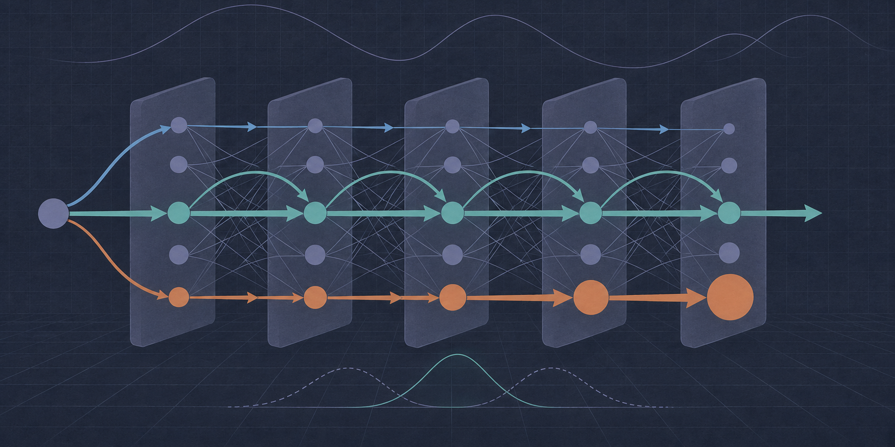
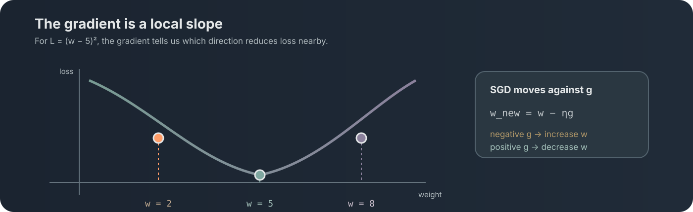
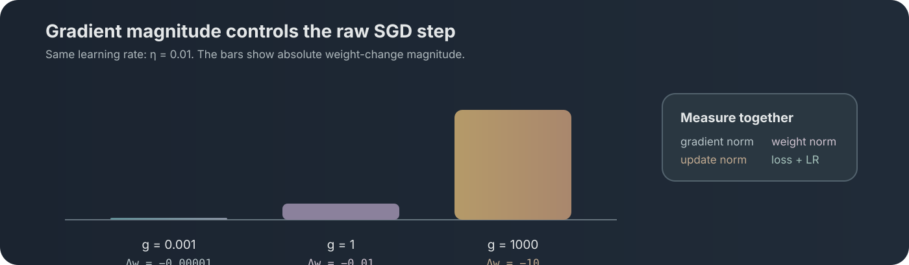
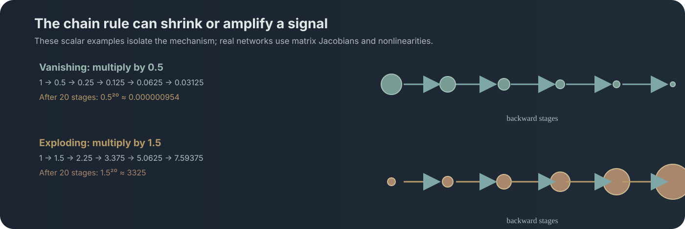
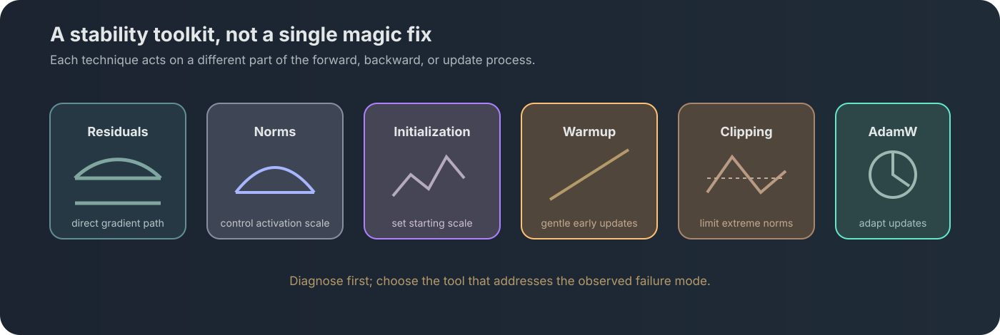
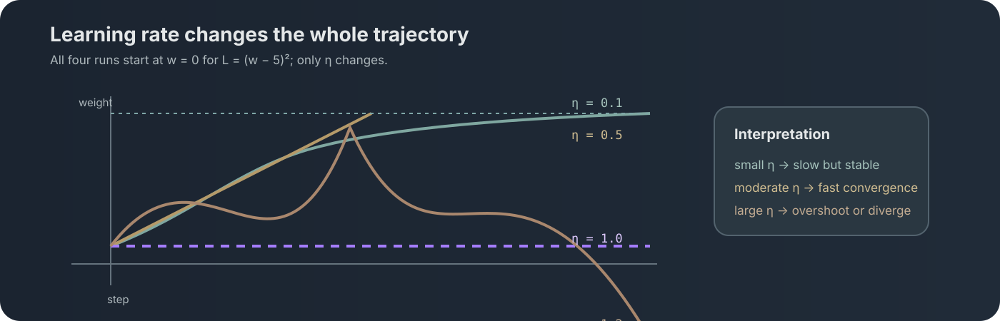

# Module 02 — Understanding Gradients and Training Stability

**LLM Training Engineering · Training fundamentals**



> **The central idea:** a gradient tells us how the loss changes locally, but training health depends on how gradients combine with the learning rate, optimizer, architecture, data, and numerical precision.

In the previous chapter, we saw that `loss.backward()` computes gradients and `optimizer.step()` updates model parameters. This chapter answers the next set of questions:

- What does a gradient of `0.001`, `1`, or `1000` mean?
- Why can gradients become almost zero or extremely large?
- Why can a training run fail even when the gradients are mathematically correct?
- How do we identify problematic gradients in a real PyTorch model?

The runnable experiments are in [`notebooks/02-understand-gradient.ipynb`](../notebooks/02-understand-gradient.ipynb).

## 1. What does a gradient mean?

Start with a model that has one weight:

$$
\hat{y} = wx
$$

For this chapter, use the simple loss:

$$
L = (w - 5)^2
$$

The minimum occurs at $w=5$, and the derivative is:

$$
\frac{dL}{dw} = 2(w-5)
$$

The gradient is a **local slope**. It tells us what would happen to the loss after a small change in one direction; it is not a complete instruction about the final size of the optimizer update.



> **Pause and predict:** at `w = 2`, is the gradient positive or negative? Should SGD increase or decrease the weight?

For plain SGD:

$$
w_{\text{new}} = w_{\text{old}} - \eta g
$$

where $\eta$ is the learning rate and $g$ is the gradient.

Three cases are worth remembering:

1. **Negative gradient:** increasing the parameter locally reduces the loss.
2. **Positive gradient:** decreasing the parameter locally reduces the loss.
3. **Zero gradient:** the loss is locally flat with respect to that parameter. The whole model is not necessarily optimal.

### Try the scalar calculation

```python
def scalar_step(weight, learning_rate=0.1):
    loss = (weight - 5.0) ** 2
    gradient = 2.0 * (weight - 5.0)
    next_weight = weight - learning_rate * gradient
    return loss, gradient, next_weight


for weight in (2.0, 5.0, 8.0):
    loss, gradient, next_weight = scalar_step(weight)
    print(
        f"w={weight:>3.1f} | "
        f"loss={loss:>5.2f} | "
        f"gradient={gradient:>5.2f} | "
        f"next_w={next_weight:>5.2f}"
    )
```

Expected output:

```text
w=2.0 | loss= 9.00 | gradient=-6.00 | next_w= 2.60
w=5.0 | loss= 0.00 | gradient= 0.00 | next_w= 5.00
w=8.0 | loss= 9.00 | gradient= 6.00 | next_w= 7.40
```

## 2. What does gradient magnitude tell us?

Consider three parameters with the same current value but different gradients:

| Parameter | Weight | Gradient |
| --- | ---: | ---: |
| $w_1$ | 0.5 | 0.001 |
| $w_2$ | 0.5 | 1.0 |
| $w_3$ | 0.5 | 1000 |

With plain SGD and learning rate $0.01$:

| Parameter | Weight change |
| --- | ---: |
| $w_1$ | −0.00001 |
| $w_2$ | −0.01 |
| $w_3$ | −10 |

The third update is 20 times larger than the current value of the parameter. That may cause instability, but the number `1000` is not automatically bad. Its meaning depends on:

- learning-rate scale;
- optimizer behavior;
- parameter scale and model size;
- loss normalization;
- batch construction;
- whether the update is finite and stable.



> **Important:** gradient magnitude measures local sensitivity. It does not, by itself, tell us whether training is healthy.

AdamW also means that the update is not simply `learning_rate * raw_gradient`; its moment estimates adapt the update using gradient history. Always inspect the actual parameter update when diagnosing stability.

## 3. Why do gradients vanish or explode?

Consider a simple chain of multiplications:

$$
h_1 = w_1x, \qquad h_2 = w_2h_1, \qquad y = w_3h_2
$$

The output is:

$$
y = w_3w_2w_1x
$$

By the chain rule:

$$
\frac{\partial y}{\partial w_1} = w_3w_2x
$$

The gradient reaching an early parameter depends on repeated transformations through later layers. If those effective multipliers are usually below one, the signal can shrink. If they are usually above one, it can grow.



### Vanishing gradients

If each stage multiplies the backward signal by `0.5`:

$$
0.5^{20} \approx 0.000000954
$$

After enough stages, early layers receive almost no useful gradient. Their parameters may learn extremely slowly.

### Exploding gradients

If each stage multiplies the signal by `1.5`:

$$
1.5^{20} \approx 3325
$$

An initial gradient of `1` can become approximately `3325`. Large updates can then cause loss spikes, overflow, or divergence.

These scalar examples isolate the mechanism. Actual neural networks use matrix Jacobians, nonlinearities, normalization, residual paths, and data-dependent activations. The principle remains: repeated transformations can dramatically change the scale of a backward signal.

## 4. Why do modern Transformers manage this better?

Transformers use several techniques that improve gradient flow and update stability:



| Technique | How it helps |
| --- | --- |
| Residual connections | Provide an additive pathway for information and gradients |
| RMSNorm or LayerNorm | Help control activation scale |
| Weight initialization | Sets a useful starting scale for signals |
| Learning-rate warmup | Reduces disruptive early updates |
| Gradient clipping | Limits excessive global gradient magnitude |
| AdamW | Adapts parameter updates using gradient statistics |

Consider a residual block:

$$
y = x + F(x)
$$

Its derivative with respect to $x$ includes the identity pathway:

$$
\frac{\partial y}{\partial x} = I + \frac{\partial F(x)}{\partial x}
$$

The identity term gives the backward signal a direct route through the block. This does not guarantee perfect gradient flow, but it makes deep networks much easier to optimize.

> **Design principle:** stability usually comes from several compatible mechanisms working together, not from one emergency fix.

## 5. What does a gradient norm tell us?

A real model contains millions or billions of gradient values. Instead of inspecting every value, we often summarize them with a norm.

For:

$$
g = [3, 4, 12]
$$

the L2 norm is:

$$
\|g\|_2 = \sqrt{3^2 + 4^2 + 12^2} = 13
$$

```python
import torch

grads = torch.tensor([3.0, 4.0, 12.0])
print(torch.linalg.vector_norm(grads, ord=2))
# tensor(13.)
```

Do not assume that a norm of `13` is healthy while `100` is unhealthy. The useful range depends on model scale, loss normalization, batch construction, optimizer, and training configuration.

### Example training log

| Step | Loss | Gradient norm | Possible interpretation |
| ---: | ---: | ---: | --- |
| 100 | 4.5 | 2.1 | Ordinary training |
| 200 | 4.0 | 1.8 | Loss improving |
| 300 | 3.7 | 2.4 | Loss improving |
| 400 | 9.8 | 850 | Large gradient and loss spike |
| 401 | 35.0 | 2,500 | Potential divergence |
| 402 | `NaN` | `NaN` | Non-finite training state |

These values are hypothetical. A large spike is a reason to investigate, not proof that gradients alone caused the failure. A bad data batch, excessive learning rate, or numerical overflow could be involved.

Also keep **gradient norm**, **weight norm**, and **update norm** separate:

- Gradient norm: how large the loss derivative is.
- Weight norm: how large the parameters currently are.
- Update norm: how much the optimizer actually changed the parameters.

## 6. Experiment: observe vanishing and exploding gradients

The following experiment uses a deep stack of linear layers. It intentionally omits residual connections and normalization so the effect is easy to see.

```python
import matplotlib.pyplot as plt
import torch
import torch.nn as nn

torch.manual_seed(42)


class DeepLinear(nn.Module):
    def __init__(self, depth=20, scale=1.0):
        super().__init__()
        self.layers = nn.ModuleList()
        for _ in range(depth):
            layer = nn.Linear(32, 32, bias=False)
            # Orthogonal weights isolate the effect of scale.
            nn.init.orthogonal_(layer.weight)
            with torch.no_grad():
                layer.weight.mul_(scale)
            self.layers.append(layer)

    def forward(self, x):
        for layer in self.layers:
            x = layer(x)
        return x


def inspect_gradients(scale, depth=20):
    model = DeepLinear(depth=depth, scale=scale)
    x = torch.randn(8, 32)
    output = model(x)
    objective = output.square().mean()
    objective.backward()

    return [
        layer.weight.grad.norm().item()
        for layer in model.layers
    ]


scales = (0.5, 1.0, 1.5)
gradient_by_scale = {
    scale: inspect_gradients(scale)
    for scale in scales
}

for scale, values in gradient_by_scale.items():
    print(
        f"scale={scale}: "
        f"first={values[0]:.3e}, "
        f"last={values[-1]:.3e}"
    )

for scale, values in gradient_by_scale.items():
    plt.semilogy(values, marker="o", label=f"scale={scale}")

plt.xlabel("Layer index")
plt.ylabel("Gradient norm, log scale")
plt.title("Gradient scale through a deep linear stack")
plt.legend()
plt.grid(alpha=0.25)
plt.show()
```

Expected qualitative behavior:

- **Scale 0.5:** earlier layers receive very small gradients.
- **Scale 1.0:** orthogonal transformations help preserve gradient scale.
- **Scale 1.5:** earlier layers can receive much larger gradients.

This is a controlled demonstration, not a prediction of what gradients in a modern Transformer will look like. Residual connections, normalization, nonlinearities, and initialization change the behavior substantially.

## 7. Experiment: learning-rate instability

Return to the scalar loss:

$$
L = (w-5)^2
$$

Its SGD update is:

$$
w_{t+1} = w_t - 2\eta(w_t-5)
$$

Starting at `w = 0`, the learning rate changes the trajectory:



```python
import matplotlib.pyplot as plt


def run_sgd(learning_rate, steps=10, initial_weight=0.0):
    weight = initial_weight
    weights = [weight]

    for _ in range(steps):
        gradient = 2.0 * (weight - 5.0)
        weight -= learning_rate * gradient
        weights.append(weight)

    return weights


learning_rates = (0.1, 0.5, 1.0, 1.2)

for learning_rate in learning_rates:
    weights = run_sgd(learning_rate)
    losses = [(weight - 5.0) ** 2 for weight in weights]
    print(
        f"lr={learning_rate}: "
        f"final_weight={weights[-1]:.4f}, "
        f"final_loss={losses[-1]:.4f}"
    )

    plt.plot(losses, marker="o", label=f"lr={learning_rate}")

plt.xlabel("SGD step")
plt.ylabel("Loss")
plt.title("Learning-rate stability on a quadratic loss")
plt.yscale("log")
plt.legend()
plt.grid(alpha=0.25)
plt.show()
```

For this exact quadratic, a learning rate of `0.1` converges smoothly, `0.5` reaches the minimum in one step, `1.0` oscillates, and `1.2` diverges. Real LLM training does not have one universal safe learning-rate threshold, but the lesson transfers:

> A training run can fail even when every gradient is mathematically correct if the optimizer takes steps that are too large.

## 8. Gradient debugging in a real training loop

Use a report that records more than one statistic per parameter:

```python
import torch


def gradient_report(model):
    results = []

    for name, parameter in model.named_parameters():
        if parameter.grad is None:
            results.append({
                "name": name,
                "grad_norm": None,
                "grad_max": None,
                "grad_mean": None,
                "finite": None,
                "status": "missing",
            })
            continue

        gradient = parameter.grad.detach()
        finite = torch.isfinite(gradient).all().item()
        results.append({
            "name": name,
            "grad_norm": gradient.float().norm().item(),
            "grad_max": gradient.abs().max().item(),
            "grad_mean": gradient.float().mean().item(),
            "finite": finite,
            "status": "ok" if finite else "non-finite",
        })

    return results


# Run after loss.backward() and before optimizer.step().
report = gradient_report(model)
for row in report[:10]:
    print(row)
```

Investigate four questions:

1. **Does a trainable parameter have `grad=None`?** It might be unused in the current computation, intentionally frozen, or disconnected from the loss.
2. **Are gradients exactly zero?** The model may be in a flat or saturated region, or a branch may be inactive.
3. **Are gradients non-finite?** Check for overflow, invalid operations, or corrupted inputs.
4. **Do some layers consistently receive unusually small or large gradients?** Compare them over time rather than judging one step.

For a routed MoE model, an expert may receive no tokens in one batch. That expert can legitimately have no useful gradient update on that step; the important question is whether this happens persistently or creates load imbalance.

## 9. What should you do when gradients explode?

Use the observation to choose the next investigation:

| Observation | Investigate first | Possible action |
| --- | --- | --- |
| Loss suddenly spikes | Data batch, learning rate, gradient norm | Inspect the batch and recent updates |
| Gradients grow consistently | Learning rate, initialization, normalization | Test a lower learning rate and inspect layers |
| `NaN` gradients | FP16 overflow, invalid math, bad inputs | Check finite values; try BF16 or FP32 |
| Gradients are near zero | Saturation, disconnected graph, scale | Inspect layer-wise gradients and activations |
| Huge gradients but stable updates | Optimizer normalization, clipping | Measure actual parameter deltas first |

Avoid blindly applying gradient clipping to every issue. Clipping can limit large finite gradients, but it does not fix invalid data, a broken loss function, or an operation that has already produced `NaN`.

<details>
<summary>When is gradient clipping appropriate?</summary>

Gradient clipping is a guardrail for unusually large finite gradients. It is useful when rare spikes would otherwise make an update unsafe. It should be paired with diagnosis: record how often clipping activates, inspect the unclipped norm, and verify that the underlying data and numerical operations are valid.

</details>

## Final mental model

- **Gradient direction** tells us how a small parameter change affects loss locally.
- **Gradient magnitude** tells us local sensitivity, not whether training is healthy on its own.
- **Vanishing and exploding gradients** can arise from repeated transformations during backpropagation.
- **Residuals, normalization, initialization, warmup, clipping, and AdamW** each address different stability pressures.
- **Training stability depends on the actual update**, not only on the raw gradient.

In practical LLM engineering, the useful question is rarely “Are my gradients large?” Ask instead:

> **Are my gradients producing stable, meaningful parameter updates?**

## Quick knowledge check

1. What does a negative gradient mean for one parameter?
   - The weight must be negative
   - Locally, increasing that parameter would reduce loss
   - The model is diverging

2. What can cause vanishing gradients?
   - Repeated backward multiplications with small effective factors
   - Calling `optimizer.step()`
   - Using a batch size larger than one

3. A model has very large gradient norms. What is the right conclusion?
   - Training must be failing
   - Immediately reset all weights
   - Inspect learning rate, optimizer updates, and loss behavior

<details>
<summary>Reveal the answers</summary>

1. Locally, increasing the parameter would reduce the loss.
2. Repeated backward multiplications with small effective factors.
3. Inspect the learning rate, optimizer updates, and loss behavior.

</details>
