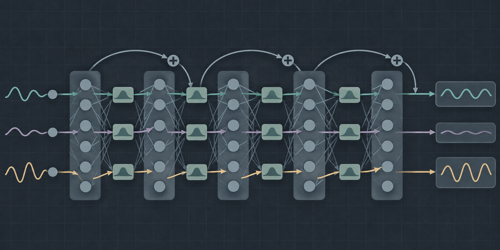
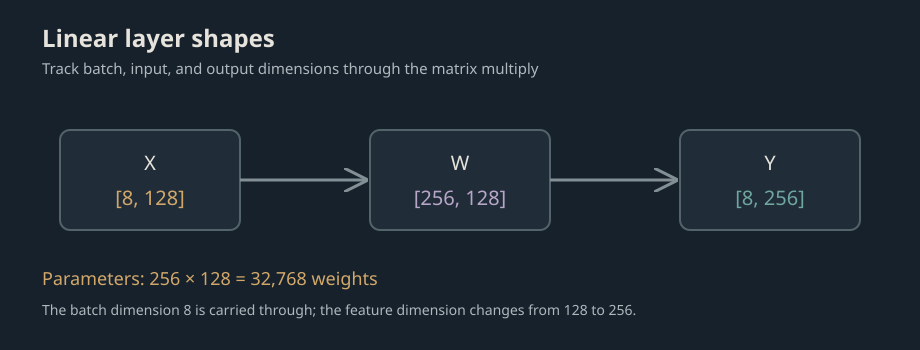
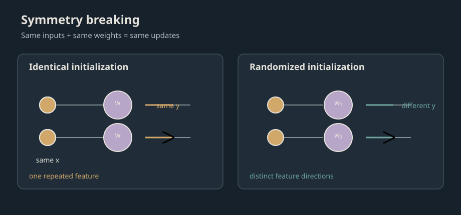
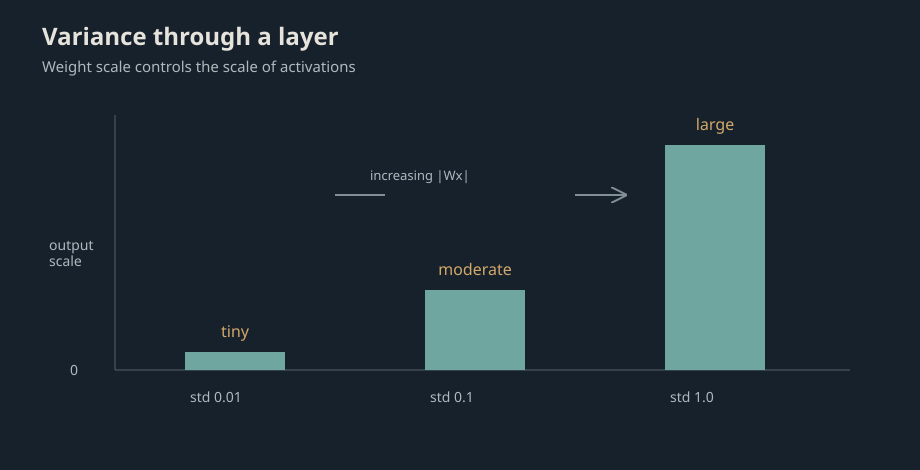
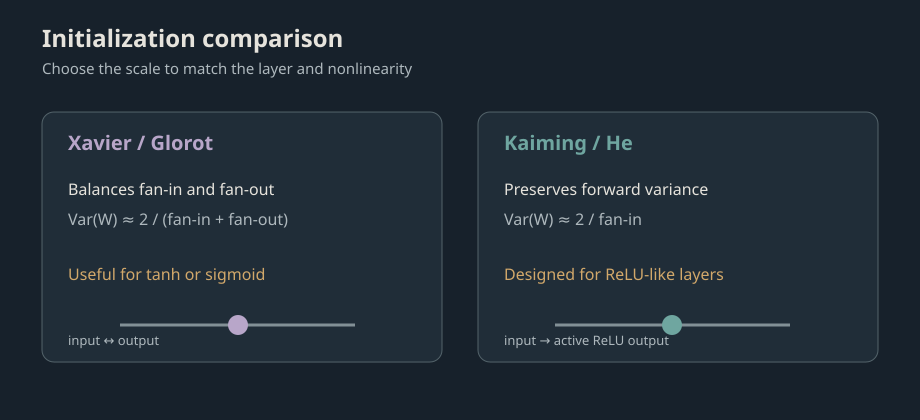
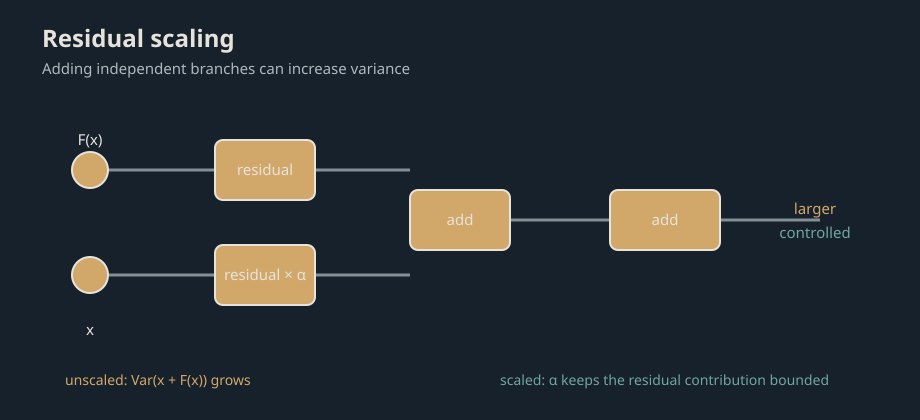
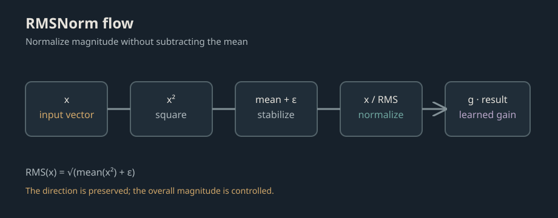

# Module 03 — Weight Initialization, Activations, and Residual Scaling

**LLM Training Engineering · Training fundamentals**



> **The central idea:** initialization is not merely a way to make weights random. It sets the scale of activations and gradients before the first optimizer step.

Imagine a 24-layer Transformer that has not been trained yet. You pass random tokens through it and find that:

- hidden-state values become very large in deeper layers;
- gradients in early layers are almost zero;
- the first optimizer steps cause large loss spikes;
- two identical models train very differently.

One possible cause is poor weight initialization or uncontrolled activation scale. This chapter builds the intuition and the experiments needed to investigate that class of failure.

The runnable experiments are in [`notebooks/03-weight-init-activations.ipynb`](../notebooks/03-weight-init-activations.ipynb).

## What you will learn

1. Why zero, tiny, and huge initializations can be problematic.
2. How initialization affects activations and gradients.
3. When Xavier and Kaiming initialization are useful.
4. Why residual streams can grow with depth.
5. How RMSNorm and residual scaling influence signal scale.
6. How to inspect a model before spending time on a long training run.

## 1. What exactly are we initializing?

Consider a linear layer:

$$
y = xW + b
$$

Suppose:

| Quantity | Value |
| --- | ---: |
| Batch size | 8 |
| Input dimension | 128 |
| Output dimension | 256 |

The input has shape `[8, 128]`. PyTorch stores the linear-layer weight as `[256, 128]`, while the output has shape `[8, 256]`.



The weight matrix contains:

$$
128 \times 256 = 32{,}768
$$

trainable numbers. Initialization chooses the starting values of those numbers.

The question is not simply “should the values be random?” It is:

> **What distribution keeps the forward activations and backward gradients at a useful scale?**

## 2. Why not initialize every weight to zero?

Imagine two hidden neurons with identical weights and biases. Given the same input, they produce identical outputs. Under the same loss, they also receive identical gradients, so their parameters continue evolving identically.

The network effectively loses the benefit of having two independent neurons. This is the **symmetry problem**.



Random initialization breaks the symmetry so that neurons can specialize differently.

> **Important nuance:** zero initialization is not always wrong. Zero-initializing a selected output projection or adapter branch can be intentional. The problem is initializing an entire symmetric hidden network identically without another mechanism that breaks the symmetry.

## 3. Why scale matters

For one output of a linear layer:

$$
y = \sum_{i=1}^{d} x_i w_i
$$

If the inputs and weights are independent, zero-mean random variables, a useful approximation is:

$$
\operatorname{Var}(y) = d\operatorname{Var}(x)\operatorname{Var}(w)
$$

Suppose the input variance is 1 and the input dimension is 100. If the weight variance is also 1:

$$
\operatorname{Var}(y)=100
$$

so the output standard deviation is 10. Repeating this through many layers can make the signal grow rapidly.

If the weight variance is extremely small, activations can instead shrink toward zero.



The design principle is:

> **Initialize weights so that activation and gradient scales remain reasonably controlled across depth.**

## 4. Xavier initialization

Xavier initialization, also called Glorot initialization, aims to balance signal scale using both incoming and outgoing dimensions.

Let:

- `fan_in` be the number of incoming connections;
- `fan_out` be the number of outgoing connections.

Xavier normal initialization uses:

$$
\operatorname{Var}(W)=\frac{2}{fan_{in}+fan_{out}}
$$

For 128 inputs and 256 outputs:

$$
\operatorname{Var}(W)=\frac{2}{384}
$$

and:

$$
\operatorname{Std}(W)\approx0.072
$$

That is very different from choosing a standard deviation of 1 without regard to layer dimensions.

```python
import torch
import torch.nn as nn

layer = nn.Linear(128, 256)
nn.init.xavier_normal_(layer.weight)
nn.init.zeros_(layer.bias)

print("Weight shape:", layer.weight.shape)
print("Weight mean:", layer.weight.mean().item())
print("Weight std:", layer.weight.std().item())
```

Xavier is commonly associated with linear or approximately symmetric activations such as `tanh`. Its assumptions are not perfect for every architecture.

## 5. Kaiming initialization

Kaiming initialization, also called He initialization, is designed for ReLU-style networks. ReLU removes negative values:

$$
\operatorname{ReLU}(x)=\max(0,x)
$$

Under common assumptions, ReLU retains roughly half of the input’s second moment. Kaiming initialization compensates for that reduction.

For the standard ReLU case:

$$
\operatorname{Var}(W)\approx\frac{2}{fan_{in}}
$$

```python
layer = nn.Linear(128, 256)
nn.init.kaiming_normal_(
    layer.weight,
    mode="fan_in",
    nonlinearity="relu",
)
nn.init.zeros_(layer.bias)

print("Weight std:", layer.weight.std().item())
```

### Xavier versus Kaiming



| Property | Xavier | Kaiming |
| --- | --- | --- |
| Common association | Tanh and linear layers | ReLU networks |
| Typical variance | $2/(fan_{in}+fan_{out})$ | $2/fan_{in}$ |
| Main objective | Balance forward and backward signal scale | Account for ReLU behavior |
| Common historical use | MLPs and earlier deep networks | Deep CNNs and ReLU networks |

Modern Transformers often use architecture-specific initialization instead of applying either rule uniformly. SwiGLU gating, residual pathways, normalization placement, and depth all affect the choice.

## 6. Why residual connections create another challenge

A Transformer block adds a sublayer output to its input:

$$
x_{l+1}=x_l+F_l(x_l)
$$

Suppose, for intuition, that $x_l$ has variance 1, $F_l(x_l)$ has variance 1, and the two terms are uncorrelated. Then:

$$
\operatorname{Var}(x_{l+1})=1+1=2
$$

If each residual branch contributes independent variance, the residual stream can accumulate scale with depth. This does not mean every Transformer doubles its variance at every layer: correlations, normalization, learned weights, and architecture-specific scaling all matter.



One possible design is:

$$
x_{l+1}=x_l+\alpha F_l(x_l)
$$

where $\alpha$ controls the residual branch contribution.

Some Transformer initialization schemes instead scale selected residual output projections with a depth-dependent factor such as:

$$
\frac{1}{\sqrt{2N}}
$$

where $N$ is the number of Transformer blocks and the factor accounts for two residual branches per block. For a 24-layer model:

$$
\frac{1}{\sqrt{48}}\approx0.1443
$$

This should not be applied blindly to every parameter. It is an architecture-dependent choice.

## 7. What does RMSNorm do?

Given a hidden vector:

$$
x=[2,4,6,8]
$$

RMSNorm computes:

$$
\operatorname{RMS}(x)=\sqrt{\frac{2^2+4^2+6^2+8^2}{4}}
$$

so:

$$
\operatorname{RMS}(x)=\sqrt{30}\approx5.477
$$

Ignoring epsilon and learned scale for this example:

$$
\operatorname{RMSNorm}(x)\approx[0.365,0.730,1.095,1.461]
$$

The output RMS is approximately 1.



In a pre-normalized Transformer:

$$
x_{l+1}=x_l+F(\operatorname{RMSNorm}(x_l))
$$

RMSNorm controls the input scale entering the sublayer. It does not guarantee that the residual stream itself cannot grow. That is why normalization, initialization, and residual design must be considered together.

## 8. Experiment: watch activations grow or shrink

This experiment uses linear layers without nonlinearities or residual connections so that initialization scale is isolated.

```python
import matplotlib.pyplot as plt
import torch
import torch.nn as nn

torch.manual_seed(42)


def run_experiment(scale, depth=20, dim=128):
    layers = []
    for _ in range(depth):
        layer = nn.Linear(dim, dim, bias=False)
        nn.init.normal_(
            layer.weight,
            mean=0.0,
            std=scale / (dim ** 0.5),
        )
        layers.append(layer)

    x = torch.randn(256, dim)
    stds = [x.std().item()]

    with torch.no_grad():
        for layer in layers:
            x = layer(x)
            stds.append(x.std().item())

    return stds


plt.figure(figsize=(9, 5))
for scale in (0.5, 1.0, 1.5):
    values = run_experiment(scale)
    plt.plot(
        range(len(values)),
        values,
        marker="o",
        label=f"scale={scale}",
    )

plt.yscale("log")
plt.xlabel("Layer")
plt.ylabel("Activation standard deviation")
plt.title("Initialization scale versus activation growth")
plt.legend()
plt.grid(alpha=0.25)
plt.show()
```

Expected qualitative behavior:

| Scale | Expected behavior |
| ---: | --- |
| 0.5 | Activations shrink rapidly |
| 1.0 | Activations remain approximately controlled |
| 1.5 | Activations grow rapidly |

Try changing `depth=20` to `depth=50`. The difference should become more pronounced.

## 9. Experiment: residual branches with and without scaling

To compare only the residual coefficient, use the same underlying weights for every configuration.

```python
import matplotlib.pyplot as plt
import torch
import torch.nn as nn

torch.manual_seed(42)


class ResidualStack(nn.Module):
    def __init__(self, weight_templates, alpha=1.0):
        super().__init__()
        self.layers = nn.ModuleList(
            [nn.Linear(128, 128, bias=False) for _ in weight_templates]
        )
        for layer, template in zip(self.layers, weight_templates):
            with torch.no_grad():
                layer.weight.copy_(template)
        self.alpha = alpha

    def forward(self, x):
        stds = [x.std().item()]
        for layer in self.layers:
            x = x + self.alpha * layer(x)
            stds.append(x.std().item())
        return stds


base_layers = []
for _ in range(24):
    weight = torch.empty(128, 128)
    nn.init.normal_(weight, std=0.02)
    base_layers.append(weight)

x = torch.randn(256, 128)
plt.figure(figsize=(9, 5))

for alpha in (1.0, 0.5, 0.2):
    model = ResidualStack(base_layers, alpha=alpha)
    values = model(x.clone())
    plt.plot(
        range(len(values)),
        values,
        label=f"residual alpha={alpha}",
    )

plt.xlabel("Residual block")
plt.ylabel("Activation standard deviation")
plt.title("Impact of residual-branch scaling")
plt.legend()
plt.grid(alpha=0.25)
plt.show()
```

Larger residual coefficients should generally produce stronger activation growth. Because every configuration uses the same weight templates, the comparison isolates `alpha` more cleanly.

## 10. How this connects to real LLMs

| Design choice | Purpose |
| --- | --- |
| Embedding initialization | Establish reasonable token-representation scale |
| Attention projection initialization | Control query, key, value, and output scales |
| MLP initialization | Control feed-forward activations |
| Residual projection scaling | Manage contributions from many residual branches |
| RMSNorm or LayerNorm | Control sublayer input scale and improve optimization |
| Pre-norm architecture | Provide favorable gradient pathways through residual streams |

In a DeepSeek-style model, MLA projections, SwiGLU layers, shared experts, routed experts, router projections, and RMSNorm layers all need sensible initialization. They do not necessarily use the same rule.

For example, router initialization can influence early expert-selection behavior, while residual output projection scale can influence how strongly a new block perturbs the residual stream.

The correct initialization depends on the architecture and training recipe.

## 11. Inspect a model before training

If the loss is already extremely high at step 0, inspect the model before changing the optimizer:

```python
def inspect_parameters(model):
    for name, parameter in model.named_parameters():
        if not parameter.requires_grad:
            continue

        values = parameter.detach().float()
        print(
            name,
            "shape:", tuple(values.shape),
            "mean:", round(values.mean().item(), 5),
            "std:", round(values.std(unbiased=False).item(), 5),
            "max_abs:", round(values.abs().max().item(), 5),
            "finite:", torch.isfinite(values).all().item(),
        )
```

For a real model, also measure hidden-state statistics at multiple depths:

- activation mean and standard deviation;
- activation RMS;
- fraction of non-finite activations;
- gradient norms by layer after one backward pass;
- initial logits and initial loss.

For next-token prediction with approximately uniform logits, cross-entropy is close to $\ln(V)$. With a vocabulary of 50,000:

$$
\ln(50000)\approx10.82
$$

This is a reference point, not a guarantee. Non-uniform logits, masking, target weighting, or other design choices can change the initial loss.

## 12. A practical initialization workflow

1. Start with the initialization used by the architecture you are implementing.
2. Verify normalization placement and residual projection scaling.
3. Inspect initial activations and loss before a long training run.
4. Check gradient norms after the first backward pass.
5. Change one initialization choice at a time when experimenting.

Avoid applying Xavier or Kaiming uniformly to every parameter without considering the architecture. Normalization parameters, embeddings, router weights, and residual projections may require different treatment.

## Final mental model

- **Initialization is about scale, not only randomness.**
- **Xavier and Kaiming** control signal propagation under different assumptions.
- **Residual connections help gradient flow**, but repeated residual additions can also grow activation scale.
- **Normalization, residual scaling, and initialization work together** to make deep Transformer training practical.

## Quick knowledge check

1. Why can initializing all hidden neurons identically be problematic?
   - They receive identical gradients and may remain symmetric
   - The optimizer automatically freezes them
   - All output logits must become `NaN`

2. What is the main purpose of Xavier or Kaiming initialization?
   - Make training loss zero immediately
   - Control signal scale through layers
   - Remove the need for an optimizer

3. In a pre-norm residual block, what does RMSNorm directly normalize?
   - Every parameter gradient
   - The final residual stream after all blocks
   - The input entering the sublayer

<details>
<summary>Reveal the answers</summary>

1. Identical hidden neurons receive identical gradients and may remain symmetric.
2. The purpose is to control signal scale through layers.
3. RMSNorm directly normalizes the input entering the sublayer.

</details>
