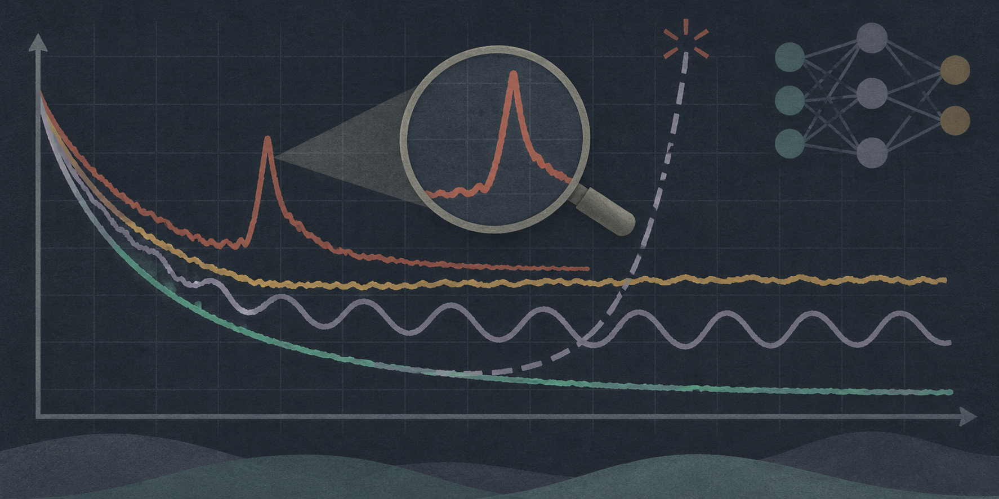
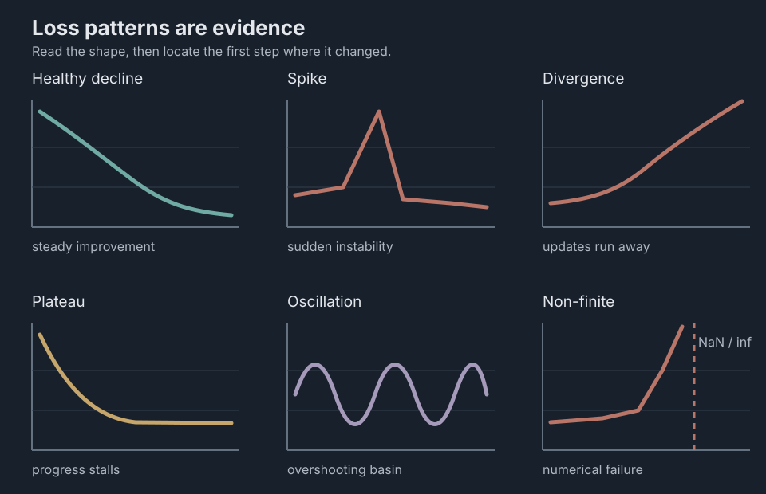
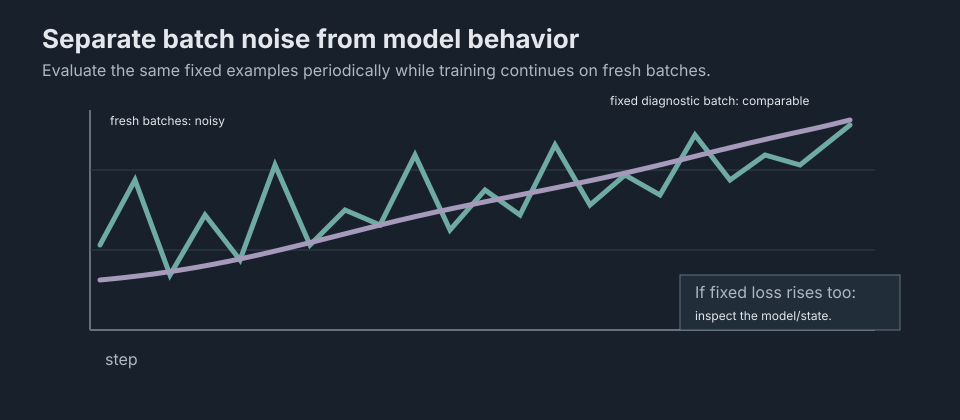
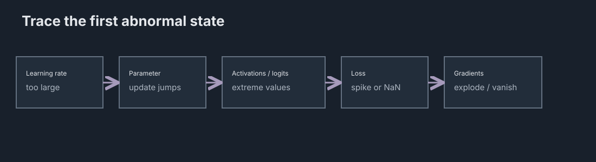
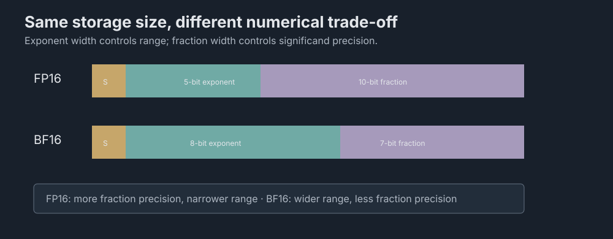
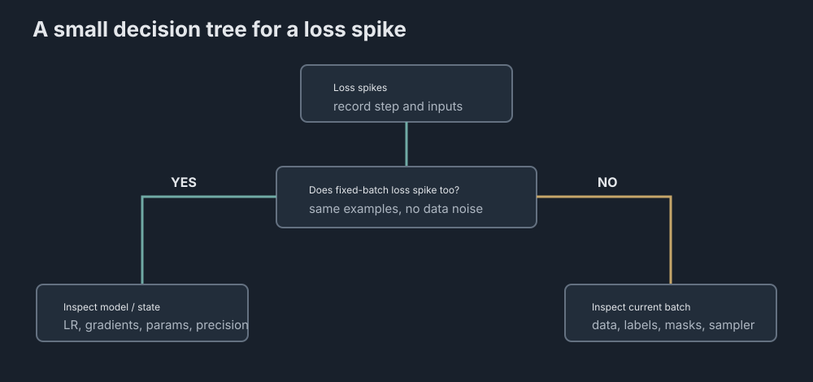
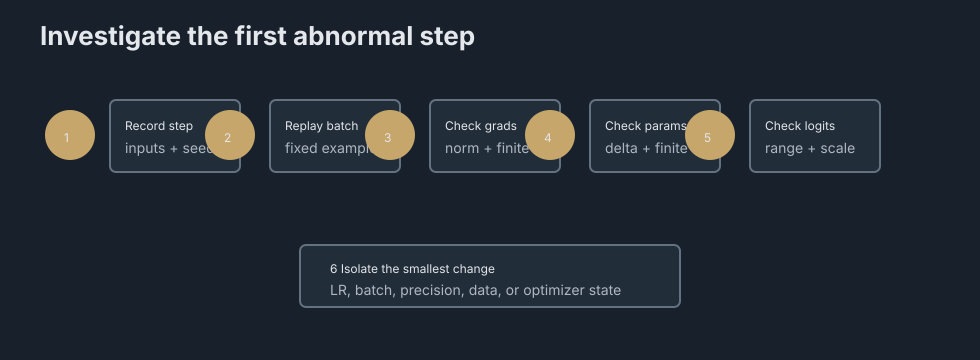

# Module 04 — Diagnosing Training Loss

**LLM Training Engineering · Training fundamentals**



> **The central idea:** a loss curve is a symptom, not a diagnosis. Find the first abnormal step, then compare the data, model state, gradients, updates, and numerical values.

Imagine training a small language model:

```text
Step 100  | Loss: 4.52
Step 200  | Loss: 4.11
Step 300  | Loss: 3.78
Step 400  | Loss: 3.55
Step 500  | Loss: 27.8
Step 501  | Loss: 89.2
Step 502  | Loss: NaN
```

Should you reduce the learning rate, add gradient clipping, change initialization, or restart training?

The correct first move is to diagnose what changed before changing the system.

The runnable experiments are in [`notebooks/04-diagnosing-train-loss.ipynb`](../notebooks/04-diagnosing-train-loss.ipynb).

## 1. Six loss patterns to recognize



| Pattern | What it looks like | First questions to ask |
| --- | --- | --- |
| Healthy decline | Loss trends downward with ordinary batch noise | Is the fixed diagnostic loss also improving? |
| Sudden spike | One or a few steps jump sharply | Was the batch unusually difficult? Did the update become large? |
| Divergence | Loss grows repeatedly after a departure point | Did learning rate, gradients, or update norms change? |
| Plateau | Loss remains roughly flat | Is optimization stalled, is capacity limited, or is the data saturated? |
| Oscillation | Loss repeatedly rises and falls | Is the learning rate too high or is batch composition changing? |
| Non-finite loss | `NaN` or `Inf` appears | Which tensor became non-finite first? |

One curve can fit several explanations. A spike might be one difficult batch even when the model is healthy, or it might follow a catastrophic optimizer update. We need more measurements to distinguish those cases.

## 2. Separate a difficult batch from a damaged model

Suppose the current-batch loss changes like this:

| Step | Current-batch loss |
| ---: | ---: |
| 100 | 3.2 |
| 101 | 3.1 |
| 102 | 12.8 |
| 103 | 3.0 |
| 104 | 2.9 |

The step-102 batch may contain complex code, unusual tokens, long sequences, or a different data mixture. A high current-batch loss does not automatically mean the model became worse.

Evaluate two things:

1. **Current training batch:** the exact examples used for the latest update.
2. **Fixed diagnostic batch:** the same held-out examples evaluated periodically.



Example interpretation:

| Measurement | Before spike | At spike |
| --- | ---: | ---: |
| Current-batch loss | 3.1 | 12.8 |
| Fixed diagnostic loss | 3.2 | 3.15 |
| Gradient norm | 1.8 | 2.1 |

The fixed batch remains healthy, which supports the difficult-batch hypothesis. More evidence may still be needed, but this is different from seeing the fixed diagnostic loss jump from 3.2 to 15.

When comparing losses, keep evaluation consistent:

- use `model.eval()` for the fixed diagnostic batch;
- use the same precision and masking rules;
- keep tokenization and target construction unchanged;
- avoid comparing losses with different reductions or sample counts.

## 3. Loss, gradients, weights, and updates are different signals

These quantities are related, but they are not interchangeable.



| Signal | Meaning | What a problem might indicate |
| --- | --- | --- |
| Loss | Objective value on the current examples | Difficult batch, bad predictions, invalid arithmetic, or divergence |
| Gradient | Derivative of the loss with respect to parameters | Large sensitivity, disconnected graph, saturation, or non-finite math |
| Weight | Current parameter values | Accumulated drift or unstable scale |
| Update | Actual change made by the optimizer | Excessive learning rate, optimizer state, or bad scaling |

A simplified failure chain might be:

```text
High learning rate
        ↓
Large parameter update
        ↓
Unstable activations or logits
        ↓
Abnormally high loss
        ↓
Large or non-finite gradients
```

This is one possible sequence, not a universal ordering. Numerical overflow or invalid data can occur earlier.

## 4. Why a high learning rate can diverge

Use the quadratic loss:

$$
L=(w-5)^2
$$

Starting at $w=0$, the gradient is:

$$
g=2(w-5)=-10
$$

SGD updates the weight with:

$$
w_{\text{new}}=w-\eta g
$$

| Learning rate | New weight | New loss | Interpretation |
| ---: | ---: | ---: | --- |
| 0.1 | 1 | 16 | Moving toward the optimum |
| 0.5 | 5 | 0 | Reaches the optimum |
| 1.0 | 10 | 25 | Overshoots and oscillates |
| 1.5 | 15 | 100 | Moves much too far |

The gradient norm alone is not enough to diagnose instability. If the learning rate is unusually high and the optimizer produces updates that change important weights dramatically, the run may become unstable.

Monitor an update-to-weight ratio:

$$
r=\frac{\|\Delta W\|_2}{\|W\|_2+\epsilon}
$$

For example:

- weight norm = 100 and update norm = 0.1 gives $r\approx0.001$;
- weight norm = 100 and update norm = 50 gives $r=0.5$.

A 50% change in one step is worth investigating, although no universal threshold applies to every layer. Small or zero-initialized parameters also require care when interpreting this ratio.

## 5. Why do `NaN` and `Inf` appear?

`Inf` can arise when a number exceeds the representable range of its data type. `NaN` can arise from invalid operations, including operations involving infinities.

```python
import torch

# Overflow in FP16.
x = torch.tensor([60000.0], dtype=torch.float16)
y = x * 2
print("Overflow:", y)  # tensor([inf], dtype=torch.float16)

# Invalid computation involving infinity.
z = y / y
print("Invalid result:", z)  # tensor([nan], dtype=torch.float16)

# A separate invalid operation.
a = torch.tensor([-1.0])
print("Invalid sqrt:", torch.sqrt(a))  # tensor([nan])
```

Attention scores are another place to think about numerical range:

$$
S=\frac{QK^\top}{\sqrt{d_k}}
$$

If intermediate values overflow in a low-precision computation, downstream operations can become non-finite. Stable attention implementations often use careful scaling and higher-precision accumulation, so do not assume that every large score causes overflow.

### FP16 versus BF16



| Property | FP16 | BF16 |
| --- | --- | --- |
| Storage | 16 bits | 16 bits |
| Exponent bits | 5 | 8 |
| Maximum finite magnitude | 65,504 | Approximately $3.39\times10^{38}$ |
| Dynamic range | Narrower | Much wider |
| Common concern | Overflow or underflow | Lower mantissa precision |

BF16’s wider exponent range helps with many FP16 overflow cases, but BF16 does not make training immune to `NaN`. Hardware support and the chosen kernel also matter.

## 6. A reusable PyTorch training debugger

The debugger below records enough information to answer:

- Is the loss finite?
- Are gradients finite?
- How large is the gradient norm?
- How much did the optimizer actually change the parameters?
- What learning rate was used?

```python
import torch
import torch.nn.functional as F


def global_norm(tensors):
    norms = [
        tensor.detach().float().norm(2)
        for tensor in tensors
        if tensor is not None
    ]
    if not norms:
        return 0.0
    return torch.linalg.vector_norm(torch.stack(norms), ord=2).item()


def debug_train_step(model, optimizer, x, y):
    model.train()
    optimizer.zero_grad(set_to_none=True)

    before = {
        name: parameter.detach().clone()
        for name, parameter in model.named_parameters()
    }

    logits = model(x)
    if not torch.isfinite(logits).all():
        raise FloatingPointError("Non-finite logits")

    loss = F.cross_entropy(
        logits.reshape(-1, logits.size(-1)),
        y.reshape(-1),
    )
    if not torch.isfinite(loss):
        raise FloatingPointError("Non-finite loss")

    loss.backward()

    gradients = [
        parameter.grad
        for parameter in model.parameters()
        if parameter.grad is not None
    ]
    if any(not torch.isfinite(gradient).all() for gradient in gradients):
        raise FloatingPointError("Non-finite gradients")

    grad_norm = global_norm(gradients)
    optimizer.step()

    parameters = list(model.parameters())
    if any(not torch.isfinite(parameter).all() for parameter in parameters):
        raise FloatingPointError("Non-finite parameters")

    update_norm = global_norm(
        parameter.detach() - before[name]
        for name, parameter in model.named_parameters()
    )
    weight_norm = global_norm(parameter for parameter in parameters)

    return {
        "loss": loss.item(),
        "grad_norm": grad_norm,
        "update_norm": update_norm,
        "weight_norm": weight_norm,
        "lr": optimizer.param_groups[0]["lr"],
    }
```

Cloning every parameter on every step is expensive for a large LLM. Use this full debugger for small experiments, periodic checks, or selected layers in production-scale training.

## 7. Hands-on experiment: deliberately break training

This toy model uses the same quadratic objective for every run, with only the learning rate changed.

```python
import matplotlib.pyplot as plt
import torch
import torch.nn as nn


def train_toy(lr, steps=20):
    torch.manual_seed(42)
    weight = nn.Parameter(torch.tensor(0.0))
    optimizer = torch.optim.SGD([weight], lr=lr)
    history = {
        "loss": [],
        "gradient": [],
        "weight": [],
    }

    for _ in range(steps):
        optimizer.zero_grad(set_to_none=True)
        loss = (weight - 5.0) ** 2
        loss.backward()

        history["loss"].append(loss.item())
        history["gradient"].append(weight.grad.item())

        optimizer.step()
        history["weight"].append(weight.item())

    return history


learning_rates = (0.1, 0.5, 1.0, 1.2)
results = {
    learning_rate: train_toy(learning_rate)
    for learning_rate in learning_rates
}

plt.figure(figsize=(9, 5))
for learning_rate, history in results.items():
    plt.plot(
        history["loss"],
        label=f"lr={learning_rate}",
    )

plt.yscale("log")
plt.xlabel("Optimizer step")
plt.ylabel("Loss, log scale")
plt.title("Learning rate and training instability")
plt.legend()
plt.grid(alpha=0.25)
plt.show()
```

Expected behavior:

| Learning rate | Expected outcome |
| ---: | --- |
| 0.1 | Gradual convergence |
| 0.5 | Reaches zero loss after the first update |
| 1.0 | Oscillates between two weights with constant loss |
| 1.2 | Loss grows exponentially |

An unstable run does not need to produce `NaN`. You can have a severe training problem while every number is still finite.

Compare the gradient and weight trajectories:

```python
for learning_rate in (0.1, 1.2):
    history = results[learning_rate]
    plt.figure(figsize=(8, 3))
    plt.plot(history["gradient"], label="gradient")
    plt.plot(history["weight"], label="weight")
    plt.title(f"Gradient and weight behavior: lr={learning_rate}")
    plt.xlabel("Training step")
    plt.legend()
    plt.grid(alpha=0.25)
    plt.show()
```

## 8. A practical loss-spike investigation

Imagine this log:

```text
Step 999  | Loss 3.21 | GradNorm 1.8 | LR 3e-4
Step 1000 | Loss 3.19 | GradNorm 1.9 | LR 3e-4
Step 1001 | Loss 9.82 | GradNorm 87  | LR 3e-4
Step 1002 | Loss 15.4 | GradNorm 240 | LR 3e-4
```

The useful question is not immediately “which hyperparameter should I change?” It is:

> **What changed between steps 1000 and 1001?**



### Recommended debugging order



1. **Find the first abnormal step.** Do not start from the final `NaN`.
2. **Inspect the corresponding data batch.** Check token IDs, masks, labels, lengths, and unusual examples.
3. **Compare fixed-input losses.** Decide whether the model worsened or the current batch was harder.
4. **Inspect numerical values.** Check activations, logits, loss, gradients, and parameters for non-finite values.
5. **Check the optimizer update.** Inspect update norm, learning rate, optimizer state, and gradient norm.
6. **Reproduce from a healthy checkpoint.** Change one suspected cause at a time while controlling data and random seeds where possible.

For mixed precision, examine loss scaling and overflow. For MoE training, inspect token distribution across experts and the scale of auxiliary balancing terms.

## 9. Locate the first non-finite value

PyTorch anomaly detection can identify certain problematic backward operations:

```python
import torch

torch.autograd.set_detect_anomaly(True)

# Debugging only:
# logits = model(x)
# loss = loss_fn(logits, y)
# loss.backward()
```

Anomaly detection adds substantial overhead and does not detect every forward-pass problem. For forward debugging, hooks can identify the first module that produces non-finite output:

```python
import torch
import torch.nn as nn


def check_finite_hook(module, inputs, output):
    del inputs
    if not isinstance(output, torch.Tensor):
        return
    if not torch.isfinite(output).all():
        raise FloatingPointError(
            f"Non-finite output in {module.__class__.__name__}"
        )


handles = []
for module in model.modules():
    if isinstance(module, nn.Linear):
        handles.append(
            module.register_forward_hook(check_finite_hook)
        )

# Run one diagnostic forward pass here.
# logits = model(x)

for handle in handles:
    handle.remove()
```

This example checks linear-layer outputs only. Non-finite values can originate in attention, normalization, loss calculations, or other operations. CUDA diagnostics can also force synchronization and slow training, so remove the instrumentation after locating the problem.

## 10. Plateau versus overfitting

A training loss that stops improving does not automatically mean overfitting. Compare training and validation behavior:

| Scenario | Training loss | Validation loss | Likely concern |
| --- | --- | --- | --- |
| A | Decreasing | Decreasing | Healthy progress |
| B | Decreasing | Increasing | Possible overfitting or distribution mismatch |
| C | Flat | Flat | Optimization, capacity, or data limitation |

In scenario B, the model fits training examples more effectively while generalizing worse. In scenario C, the model may have stopped learning meaningfully, but the cause is not automatically overfitting.

## Final mental model

- **Loss spikes are symptoms, not root causes.**
- **A difficult batch is different from a damaged model.**
- **Gradient explosion, weight growth, and loss divergence are related but distinct.**
- **`NaN` and `Inf` require investigating numerical operations, not only adjusting the optimizer.**
- **The first abnormal step is more informative than the final failure.**

## Quick knowledge check

1. Training loss spikes on one batch, but fixed diagnostic loss is stable. What is a reasonable first hypothesis?
   - The model weights definitely exploded
   - The batch may be unusually difficult
   - The optimizer is certainly broken

2. With AdamW, why is gradient norm alone insufficient?
   - AdamW uses gradient history to adapt updates
   - AdamW never uses gradients
   - AdamW always normalizes every update to 1

3. What is most useful when loss becomes `NaN`?
   - Immediately increase batch size
   - Replace every normalization layer
   - Find the first abnormal tensor or step

<details>
<summary>Reveal the answers</summary>

1. The batch may be unusually difficult.
2. AdamW uses gradient history to adapt updates.
3. Find the first abnormal tensor or step.

</details>
