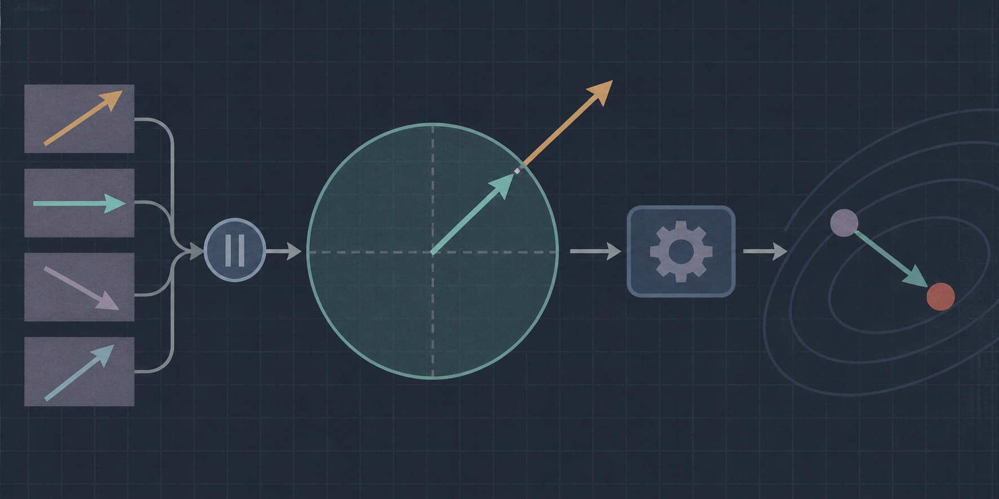
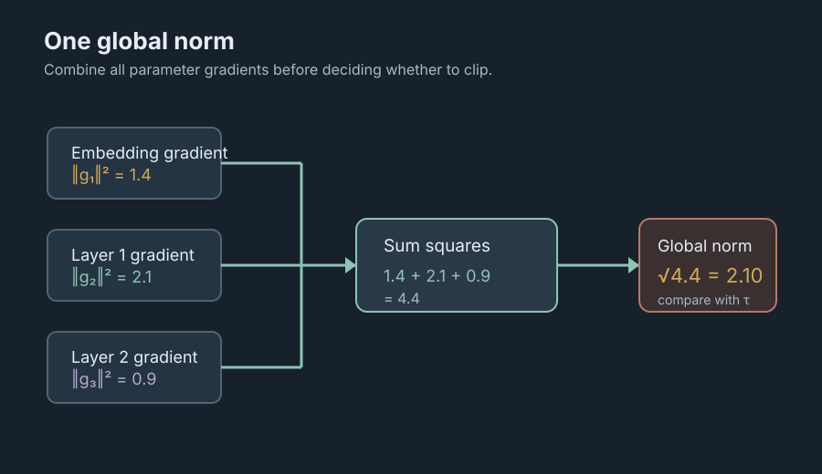
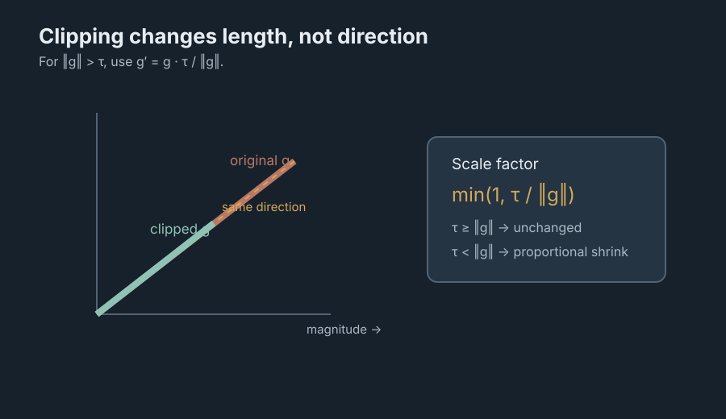
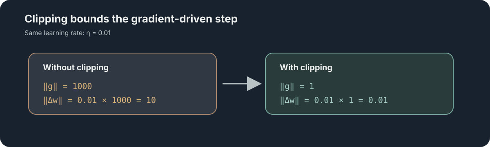
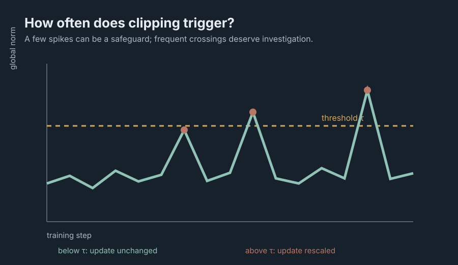
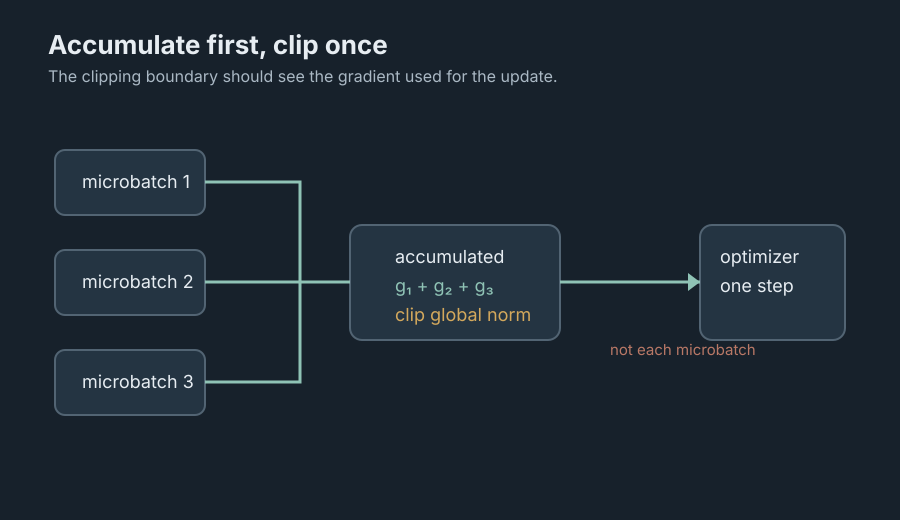
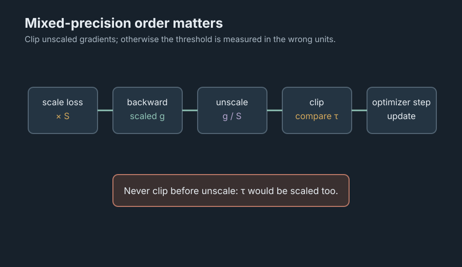
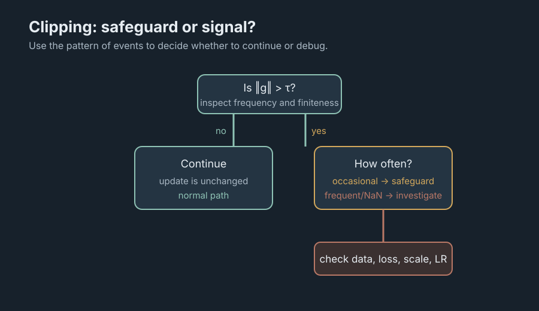

# Module 05 — Gradient Norms and Gradient Clipping

**LLM Training Engineering · Training fundamentals**



> **The central idea:** gradient clipping is a safety mechanism that limits the size of an unusually large gradient while preserving its overall direction.

Imagine a training run with this log:

```text
Step 100 | Loss 4.20 | Gradient norm 1.8
Step 101 | Loss 4.16 | Gradient norm 2.1
Step 102 | Loss 4.11 | Gradient norm 1.9
Step 103 | Loss 8.52 | Gradient norm 125.0
```

What if that unusually large gradient could be prevented from producing an excessively large update? That is the motivation behind gradient clipping.

The runnable experiments are in [`notebooks/05-graddient-norm-and-clipping.ipynb`](../notebooks/05-graddient-norm-and-clipping.ipynb).

## 1. What is a global gradient norm?

Suppose a model has one gradient vector:

$$
g=[3,4,12]
$$

Its L2 norm is:

$$
\|g\|_2=\sqrt{3^2+4^2+12^2}=13
$$

For a real model, gradients are distributed across many parameter tensors. Treat all gradient elements as one long vector:



For example:

```python
import torch


def global_norm(tensors):
    norms = [
        tensor.detach().float().norm(2)
        for tensor in tensors
        if tensor is not None
    ]
    if not norms:
        return 0.0
    return torch.linalg.vector_norm(torch.stack(norms), ord=2).item()


layer1_gradient = torch.tensor([3.0, 4.0])
layer2_gradient = torch.tensor([0.0, 12.0])

print(global_norm([layer1_gradient, layer2_gradient]))
# 13.0
```

The individual norms are 5 and 12, so the global norm is:

$$
\sqrt{5^2+12^2}=13
$$

A norm of 13 is not inherently good or bad. Its meaning depends on model scale, loss normalization, optimizer configuration, and historical behavior.

## 2. What does gradient clipping do?

Suppose the global norm is 13 and the configured threshold is:

```python
max_grad_norm = 5.0
```

The clipping algorithm scales every gradient tensor by the same factor when the global norm exceeds the threshold:

$$
s=\min\left(1,\frac{c}{\|g\|_2}\right)
$$

where $c$ is the threshold. For this example:

$$
s=\frac{5}{13}\approx0.3846
$$

so:

$$
[3,4,12]\rightarrow[1.154,1.538,4.615]
$$



All components are multiplied by the same factor. The direction of the overall gradient vector is preserved apart from numerical rounding.

## 3. Try the clipping calculation

```python
import torch


def clip_vector(gradient, max_norm):
    norm = gradient.norm()
    scale = min(1.0, max_norm / (norm.item() + 1e-12))
    clipped = gradient * scale
    return norm.item(), scale, clipped, clipped.norm().item()


gradient = torch.tensor([3.0, 4.0, 12.0])
for threshold in (20.0, 5.0, 1.0):
    before, scale, clipped, after = clip_vector(
        gradient,
        threshold,
    )
    print(
        f"threshold={threshold:>4.1f} | "
        f"before={before:>5.2f} | "
        f"scale={scale:>6.3f} | "
        f"after={after:>5.2f} | "
        f"vector={clipped.tolist()}"
    )
```

Expected behavior:

- threshold 20: no clipping;
- threshold 5: moderate clipping;
- threshold 1: strong clipping.

The direction stays the same, but the magnitude is reduced whenever the threshold is active.

## 4. Why clipping can stabilize SGD

Plain SGD uses:

$$
w_{\text{new}}=w-\eta g
$$

Suppose the learning rate is `0.01` and the gradient norm is `1000`:

$$
\|\Delta w\|=0.01\times1000=10
$$

If the gradient is clipped to norm `1`:

$$
\|\Delta w\|=0.01\times1=0.01
$$

That is a 1000-fold difference in the gradient-driven update.



For pure SGD without momentum or additional update terms, clipping directly bounds the current gradient-driven update norm. It does not bound the loss value itself, and it does not repair invalid data or `NaN` gradients.

## 5. Correct PyTorch ordering

PyTorch provides:

```python
torch.nn.utils.clip_grad_norm_
```

Use it after backpropagation and before the optimizer update:

```python
import torch
import torch.nn as nn

model = nn.Linear(4, 1)
optimizer = torch.optim.SGD(
    model.parameters(),
    lr=0.01,
)

x = torch.randn(8, 4)
y = torch.randn(8, 1)

optimizer.zero_grad(set_to_none=True)

# Forward and loss.
prediction = model(x)
loss = nn.functional.mse_loss(prediction, y)

# Backward.
loss.backward()

# Clip after backward, before optimizer.step().
grad_norm_before = torch.nn.utils.clip_grad_norm_(
    model.parameters(),
    max_norm=1.0,
)

# Update.
optimizer.step()

print("Loss:", loss.item())
print("Norm before clipping:", grad_norm_before.item())
```

The returned value is the **total norm before clipping**. To measure the post-clipping norm, call `global_norm()` again after the clipping call and before `optimizer.step()`.

The order is:

```text
zero_grad → forward → loss → backward → clip → optimizer.step
```

Clipping before `backward()` sees no new gradients. Clipping after `optimizer.step()` is too late for that update.

## 6. Why AdamW is different

For SGD:

$$
\Delta w=-\eta g
$$

Reducing the gradient by 10 times reduces the gradient-driven update by 10 times.

AdamW maintains moving statistics:

- $m$: a moving average of gradients;
- $v$: a moving average of squared gradients.

Ignoring bias correction and weight decay for the moment:

$$
\Delta w\approx-\eta\frac{m}{\sqrt{v}+\epsilon}
$$

On the first step, a gradient of 100 can be normalized by its own second moment so that its adaptive direction is close to 1. A clipped gradient of 1 can produce a similar first-step normalized direction.

This does **not** make clipping useless with AdamW. Clipping changes the first- and second-moment histories and can protect against unusual gradients relative to the normal training distribution. It simply means that clipping the raw gradient does not strictly bound the final AdamW parameter update.

| Behavior | SGD without momentum | AdamW |
| --- | --- | --- |
| Uses raw gradient directly | Yes | Uses normalized running moments |
| Clipping limits current gradient norm | Yes | Yes |
| Clipping strictly bounds total update norm | For the pure gradient update | No |
| Clipping affects future steps | No optimizer history in basic SGD | Yes, through moment estimates |

## 7. When should clipping be used?

An isolated spike:

| Step | Loss | Gradient norm |
| ---: | ---: | ---: |
| 100 | 4.20 | 1.2 |
| 101 | 4.17 | 1.4 |
| 102 | 4.15 | 1.1 |
| 103 | 4.14 | 1.3 |
| 104 | 4.40 | 98.0 |
| 105 | 4.10 | 1.5 |

may be a good case for clipping as a stability safeguard.

Consistently large gradients:

| Step | Gradient norm |
| ---: | ---: |
| 100 | 80 |
| 101 | 95 |
| 102 | 110 |
| 103 | 130 |
| 104 | 150 |

suggest that you should investigate learning rate, data, loss scaling, initialization, and architecture. If a threshold of `1.0` is active almost every step, it may be hiding a deeper problem.

| Situation | Recommendation |
| --- | --- |
| Transformer from scratch | Consider global-norm clipping; test `1.0` as a starting point |
| AdamW training | Clip if useful, but monitor actual update norms too |
| Occasional spikes | Clipping can limit their effect |
| Consistently enormous gradients | Investigate the root cause first |
| Already-small gradients | Clipping usually does nothing |
| `NaN` gradients | Find the numerical cause; clipping cannot repair them |
| Stable fine-tuning | Clipping may be useful but is not always necessary |

## 8. Monitor clipping frequency

Two useful metrics are clipping frequency and clipping factor:

$$
\text{Clipping frequency}=\frac{\text{steps where norm exceeds threshold}}{\text{total optimizer steps}}
$$



There is no universal target frequency. The right behavior depends on gradient scale, batch composition, optimizer, and training recipe. The important question is whether clipping is a rare guardrail or a permanent rescaling operation.

```python
gradient_norms = [0.7, 1.1, 0.8, 2.4, 1.2, 0.9, 8.5, 1.4, 0.8, 1.3, 0.9, 1.1]
threshold = 1.0

clipped_steps = sum(norm > threshold for norm in gradient_norms)
frequency = clipped_steps / len(gradient_norms)

print("Steps clipped:", clipped_steps, "/", len(gradient_norms))
print("Clipping frequency:", f"{frequency:.1%}")
```

## 9. Gradient accumulation

Suppose four microbatches simulate one larger batch:

$$
B_{\text{effective}}=B_{\text{micro}}\times4
$$

The usual sequence is:



1. Clear gradients once.
2. Run four forward and backward passes.
3. Divide each microbatch loss by 4 for equal weighting.
4. Clip the accumulated gradient once.
5. Update the weights once.

```python
accumulation_steps = 4
optimizer.zero_grad(set_to_none=True)

for _ in range(accumulation_steps):
    x, y = get_batch()
    logits = model(x)
    loss = torch.nn.functional.cross_entropy(
        logits.reshape(-1, logits.size(-1)),
        y.reshape(-1),
    )
    (loss / accumulation_steps).backward()

# Clip after all backward passes.
grad_norm = torch.nn.utils.clip_grad_norm_(
    model.parameters(),
    max_norm=1.0,
)
optimizer.step()
```

Clipping after every microbatch is generally not equivalent because clipping is nonlinear. If two microbatches produce gradients that partially cancel, clipping them separately changes the cancellation before accumulation.

## 10. FP16 mixed precision

When loss scaling has multiplied the gradients, unscale them before clipping:



```python
scaler = torch.amp.GradScaler("cuda")

optimizer.zero_grad(set_to_none=True)

with torch.autocast("cuda", dtype=torch.float16):
    logits = model(x)
    loss = torch.nn.functional.cross_entropy(
        logits.reshape(-1, logits.size(-1)),
        y.reshape(-1),
    )

scaler.scale(loss).backward()

# Restore true gradient values before measuring or clipping.
scaler.unscale_(optimizer)
torch.nn.utils.clip_grad_norm_(
    model.parameters(),
    max_norm=1.0,
)

scaler.step(optimizer)
scaler.update()
```

The order is:

```text
forward → scale loss → backward → unscale → clip → scaler.step → scaler.update
```

If your runtime uses a different AMP API, keep the same conceptual ordering.

## 11. Experiment: train with and without clipping

Create occasional large gradients using unusually large inputs:

```python
import matplotlib.pyplot as plt
import torch


def train_with_spikes(clip=False, steps=80):
    torch.manual_seed(42)
    weight = torch.nn.Parameter(torch.tensor(0.0))
    optimizer = torch.optim.SGD([weight], lr=0.05)

    x_values = torch.ones(steps)
    x_values[20] = 20.0
    x_values[50] = 20.0

    history = {
        "loss": [],
        "grad_before": [],
        "grad_after": [],
        "weight": [],
    }

    for step in range(steps):
        optimizer.zero_grad(set_to_none=True)
        x = x_values[step]
        y = 2.0 * x
        prediction = weight * x
        loss = (prediction - y) ** 2
        loss.backward()

        before = abs(weight.grad.item())
        if clip:
            torch.nn.utils.clip_grad_norm_([weight], max_norm=1.0)
        after = abs(weight.grad.item())

        optimizer.step()

        history["loss"].append(loss.item())
        history["grad_before"].append(before)
        history["grad_after"].append(after)
        history["weight"].append(weight.item())

    return history


unclipped = train_with_spikes(clip=False)
clipped = train_with_spikes(clip=True)

plt.figure(figsize=(9, 5))
plt.plot(unclipped["loss"], label="without clipping")
plt.plot(clipped["loss"], label="with clipping")
plt.yscale("log")
plt.xlabel("Optimizer step")
plt.ylabel("Loss, log scale")
plt.title("Training with occasional gradient spikes")
plt.legend()
plt.grid(alpha=0.25)
plt.show()
```

Inspect the spike step:

```python
print("Step 20, unclipped:", unclipped["grad_before"][20])
print("Step 20, clipped:", clipped["grad_after"][20])
print("Weight after clipped update:", clipped["weight"][20])
```

The clipped gradient should not exceed approximately 1 in this simple example. The loss on an unusual input can still be high because clipping restricts the update signal, not the model’s prediction error.

## 12. A practical decision guide



Use clipping as a stability safeguard, not as a substitute for appropriate learning rates, initialization, normalization, data validation, and numerical checks.

## Defensive implementation

During debugging, ask PyTorch to fail when the total norm is non-finite:

```python
grad_norm = torch.nn.utils.clip_grad_norm_(
    model.parameters(),
    max_norm=1.0,
    error_if_nonfinite=True,
)
print("Pre-clipping gradient norm:", grad_norm.item())
```

This prevents an optimizer step from silently proceeding with a non-finite norm, but it does not guarantee every other part of the pipeline is finite.

## Final mental model

1. Global gradient norm measures the combined magnitude of gradients across parameters.
2. Global-norm clipping scales large gradients while preserving their direction.
3. Clipping protects against disruptive spikes; it is not a cure for every training problem.
4. With AdamW, clipping the gradient does not strictly bound the final parameter update.
5. With accumulation, clip after accumulation; with scaled FP16, unscale before clipping.

> **Remember:** gradient clipping controls what the optimizer receives, not what the model predicts.

## Quick knowledge check

1. If the global norm is 10 and `max_grad_norm` is 2, what happens?
   - Every gradient becomes exactly 2
   - All gradients are multiplied by approximately 0.2
   - Only the largest gradient changes

2. Does `max_grad_norm=1` guarantee that AdamW’s weight-update norm is below 1?
   - Yes, always
   - Only when using BF16
   - No; AdamW moments and other update terms matter

3. When using gradient accumulation, when should you generally clip?
   - After accumulating all microbatch gradients, before `optimizer.step()`
   - After every individual microbatch backward
   - After `optimizer.step()`

4. In FP16 training with `GradScaler`, what must happen before clipping?
   - Run `optimizer.step()`
   - Unscale the gradients
   - Zero the gradients

<details>
<summary>Reveal the answers</summary>

1. All gradients are multiplied by approximately 0.2.
2. No; AdamW moments and other update terms matter.
3. Clip after accumulating all microbatch gradients and before the optimizer step.
4. Unscale the gradients.

</details>
