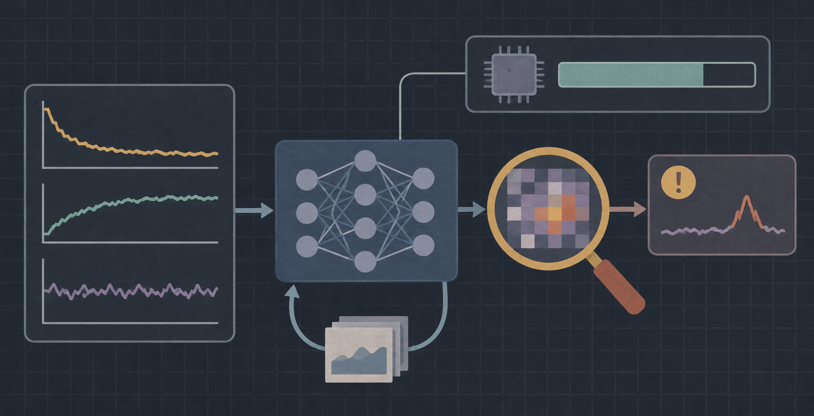
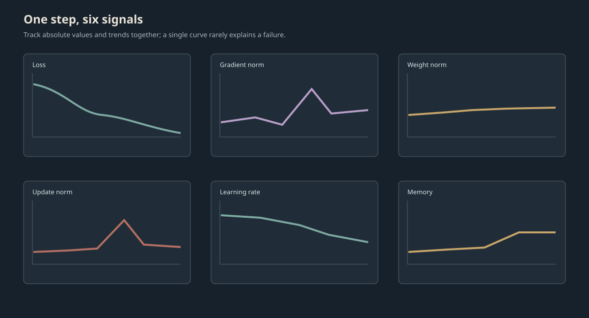
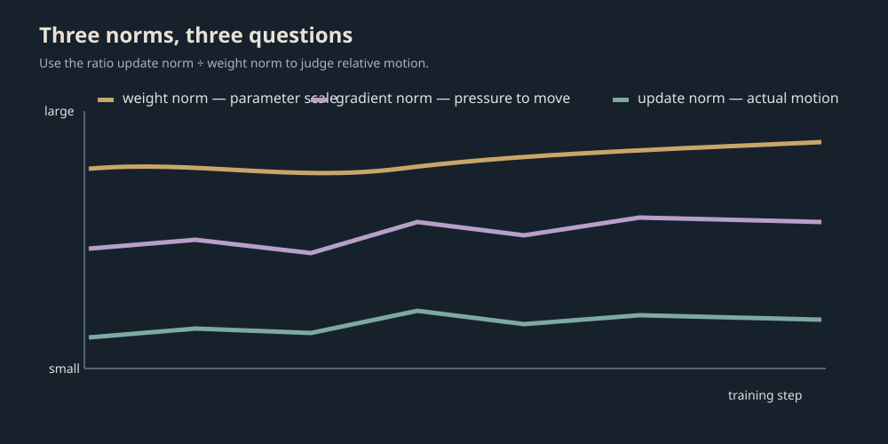
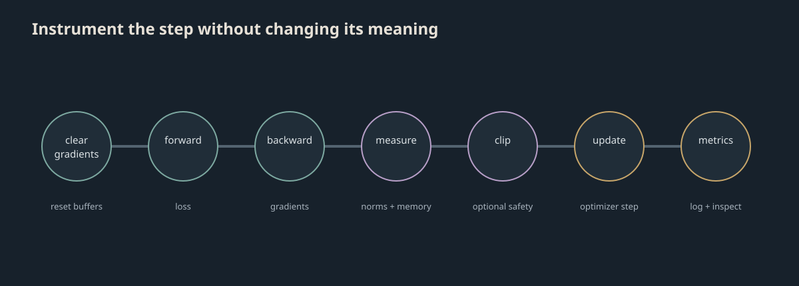
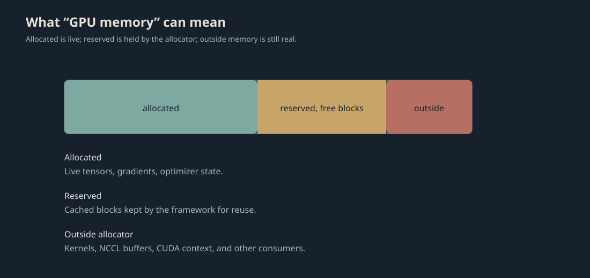
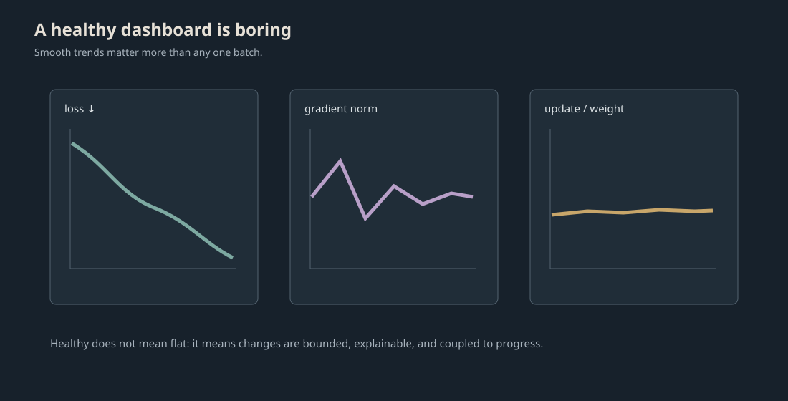
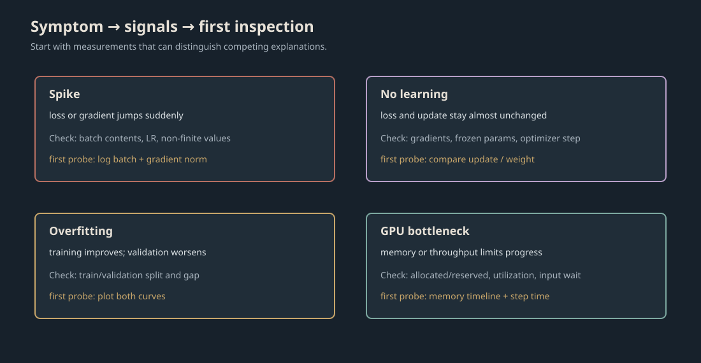

# Module 06 — Training Observability

**LLM Training Engineering · Training fundamentals**



> **The central idea:** observability means collecting enough information to understand what the model, optimizer, and hardware are doing instead of guessing from the loss curve alone.

Imagine training a 300-million-parameter language model:

```text
Step 1998 | Loss 3.42
Step 1999 | Loss 3.40
Step 2000 | Loss 3.39
Step 2001 | Loss 8.52
Step 2002 | Loss 15.8
```

What changed? The gradients may have exploded, the learning rate may be too high, the optimizer may have made a large update, or the next batch may simply be unusually difficult.

The runnable experiments are in [`notebooks/06-training-observability.ipynb`](../notebooks/06-training-observability.ipynb).

## 1. Six measurements to understand



| Metric | What it measures | Why it matters |
| --- | --- | --- |
| Training loss | Prediction error on the current examples | Is the model learning? |
| Gradient norm | Magnitude of the gradients | Are backward signals unusually large or small? |
| Weight norm | Magnitude of model parameters | Are weights growing unexpectedly? |
| Update norm | Magnitude of parameter changes | How much did the optimizer actually change? |
| Learning rate | Configured optimizer step size | Are update settings appropriate? |
| GPU memory | Allocated, reserved, and peak memory | Will the step fit on the device? |

Also log validation loss, tokens per second, and step time when those measurements are relevant.

## 2. Gradient, weight, and update norms

Suppose a model has:

$$
W=[3,4,0],\qquad G=[6,8,0],\qquad\Delta W=[-0.3,-0.4,0]
$$

These produce three different norms:



$$
\|W\|_2=5,\qquad\|G\|_2=10,\qquad\|\Delta W\|_2=0.5
$$

- **Weight norm = 5:** the current parameter vector has magnitude 5.
- **Gradient norm = 10:** the local loss sensitivity has magnitude 10.
- **Update norm = 0.5:** the optimizer actually changed the parameters by magnitude 0.5.

None of these values is inherently good or bad. Interpret them relative to model scale and historical behavior.

### Update-to-weight ratio

$$
r=\frac{\|\Delta W\|_2}{\|W_{\text{before}}\|_2+\epsilon}
$$

For the example:

$$
r=\frac{0.5}{5}=0.1=10\%
$$

This ratio is often useful layer by layer. It tells us how large the actual parameter change was relative to the parameter’s current scale.

## 3. What does the learning rate actually change?

With plain SGD, gradient norm and learning rate are separate measurements:

$$
\|\Delta W\|_2=\eta\|G\|_2
$$

For gradient norm 10 and weight norm 5:

| Learning rate | Update norm | Update-to-weight ratio |
| ---: | ---: | ---: |
| 0.001 | 0.01 | 0.2% |
| 0.010 | 0.10 | 2.0% |
| 0.100 | 1.00 | 20.0% |

The gradient norm stays 10 while the update grows with the learning rate. With AdamW, the relationship is more complicated because moment estimates and weight decay also affect the update.

To measure what the optimizer actually did:

```python
weights_before = {
    name: parameter.detach().clone()
    for name, parameter in model.named_parameters()
}

optimizer.step()

updates = [
    parameter.detach() - weights_before[name]
    for name, parameter in model.named_parameters()
]
```

This includes adaptive moments, learning rate, and decoupled weight decay. It is more informative than estimating an AdamW update from raw gradient magnitude alone.

## 4. A training monitor’s lifecycle



The essential order is:

1. Clear old gradients.
2. Optionally snapshot parameters for update measurement.
3. Run the forward pass and calculate loss.
4. Run the backward pass.
5. Measure gradient norm before clipping.
6. Apply optional clipping.
7. Run the optimizer step.
8. Measure parameter changes, timing, and memory.

The measurement point matters. A gradient norm measured after clipping answers a different question from the pre-clipping norm.

## 5. GPU memory: allocated, reserved, and peak

PyTorch exposes several CUDA memory measurements:



| Metric | Meaning |
| --- | --- |
| `memory_allocated()` | GPU memory currently occupied by tensors tracked by PyTorch |
| `memory_reserved()` | GPU memory managed by PyTorch’s caching allocator |
| `max_memory_allocated()` | Peak allocated tensor memory since the last reset |
| `max_memory_reserved()` | Peak reserved allocator memory since the last reset |

PyTorch may keep released memory blocks in its caching allocator so they can be reused. Therefore reserved memory can be larger than currently allocated memory.

### Memory reporting utility

```python
import torch


def cuda_memory_report(device=None):
    if not torch.cuda.is_available():
        return {"device": "CPU", "cuda": False}

    if device is None:
        device = torch.device("cuda")

    gigabyte = 1024 ** 3
    return {
        "device": str(device),
        "cuda": True,
        "allocated_gb": torch.cuda.memory_allocated(device) / gigabyte,
        "reserved_gb": torch.cuda.memory_reserved(device) / gigabyte,
        "peak_allocated_gb": (
            torch.cuda.max_memory_allocated(device) / gigabyte
        ),
        "peak_reserved_gb": (
            torch.cuda.max_memory_reserved(device) / gigabyte
        ),
    }


print(cuda_memory_report())
```

Before a measured step:

```python
if torch.cuda.is_available():
    torch.cuda.reset_peak_memory_stats()
```

Peak counters measure activity since their last reset. They are not automatically reset every step.

If a model uses 7 GB before forward, 10 GB during forward, 14 GB during backward, and 9 GB after the update, inspecting only the final value would understate the required memory. The peak is what determines whether the step fits.

PyTorch allocator statistics do not capture every allocation from every library or process. `nvidia-smi` provides a broader device-level view.

## 6. Build a reusable monitored training step

The function below works with any model whose output and target are accepted by the supplied `loss_fn`. It measures the actual update when `measure_updates=True`.

```python
import time
import torch


@torch.no_grad()
def global_l2_norm(tensors):
    norms = [
        tensor.detach().float().norm(2)
        for tensor in tensors
        if tensor is not None
    ]
    if not norms:
        return 0.0
    return torch.linalg.vector_norm(torch.stack(norms), ord=2).item()


def monitored_step(
    model,
    optimizer,
    x,
    y,
    loss_fn,
    *,
    max_grad_norm=None,
    measure_updates=True,
):
    model.train()
    device = x.device
    use_cuda = device.type == "cuda"

    if use_cuda:
        torch.cuda.synchronize(device)
        torch.cuda.reset_peak_memory_stats(device)

    start = time.perf_counter()
    optimizer.zero_grad(set_to_none=True)
    parameters = [
        parameter
        for parameter in model.parameters()
        if parameter.requires_grad
    ]

    before = (
        [parameter.detach().clone() for parameter in parameters]
        if measure_updates
        else None
    )

    # 1. Forward and loss.
    prediction = model(x)
    loss = loss_fn(prediction, y)
    if not torch.isfinite(loss).item():
        raise FloatingPointError("Non-finite loss")

    # 2. Backward.
    loss.backward()
    gradients = [
        parameter.grad
        for parameter in parameters
        if parameter.grad is not None
    ]
    if any(not torch.isfinite(gradient).all() for gradient in gradients):
        raise FloatingPointError("Non-finite gradient")

    # 3. Measure before optional clipping.
    grad_norm = global_l2_norm(gradients)

    if max_grad_norm is not None:
        torch.nn.utils.clip_grad_norm_(
            parameters,
            max_norm=max_grad_norm,
            error_if_nonfinite=True,
        )

    # 4. Update parameters.
    optimizer.step()
    if any(not torch.isfinite(parameter).all() for parameter in parameters):
        raise FloatingPointError("Non-finite parameter")

    if measure_updates:
        weight_norm = global_l2_norm(before)
        update_norm = global_l2_norm(
            parameter.detach() - old
            for parameter, old in zip(parameters, before)
        )
        update_ratio = update_norm / max(weight_norm, 1e-12)
    else:
        weight_norm = float("nan")
        update_norm = float("nan")
        update_ratio = float("nan")

    if use_cuda:
        torch.cuda.synchronize(device)

    elapsed = time.perf_counter() - start
    stats = {
        "loss": loss.item(),
        "grad_norm": grad_norm,
        "weight_norm": weight_norm,
        "update_norm": update_norm,
        "update_ratio": update_ratio,
        "lr": optimizer.param_groups[0]["lr"],
        "step_time_s": elapsed,
        "samples_per_sec": x.size(0) / elapsed,
    }

    if use_cuda:
        stats["peak_allocated_gb"] = (
            torch.cuda.max_memory_allocated(device) / 1024**3
        )

    return stats
```

Cloning every parameter on every step is expensive for a large LLM and retrieving scalar metrics can synchronize the GPU. Use full update measurement for small experiments, periodic checks, or selected layers in production-scale training.

## 7. Train a monitored regression model

The model learns:

$$
y=2x_1-3x_2
$$

```python
import matplotlib.pyplot as plt
import torch.nn as nn
import torch.nn.functional as F

torch.manual_seed(42)
device = torch.device("cuda" if torch.cuda.is_available() else "cpu")


class TinyRegressor(nn.Module):
    def __init__(self):
        super().__init__()
        self.net = nn.Sequential(
            nn.Linear(2, 32),
            nn.ReLU(),
            nn.Linear(32, 1),
        )

    def forward(self, x):
        return self.net(x)


model = TinyRegressor().to(device)
optimizer = torch.optim.AdamW(
    model.parameters(),
    lr=1e-3,
    weight_decay=0.0,
)


def make_batch(batch_size=128):
    x = torch.randn(batch_size, 2, device=device)
    y = 2 * x[:, 0:1] - 3 * x[:, 1:2]
    return x, y


history = []
for step in range(200):
    x, y = make_batch()
    stats = monitored_step(
        model,
        optimizer,
        x,
        y,
        loss_fn=F.mse_loss,
        max_grad_norm=1.0,
    )
    stats["step"] = step
    history.append(stats)

    if step % 20 == 0:
        print(
            f"Step {step:03d} | "
            f"Loss {stats['loss']:.4f} | "
            f"Grad {stats['grad_norm']:.3f} | "
            f"Update ratio {stats['update_ratio'] * 100:.4f}%"
        )
```

The model should generally learn the simple function. Gradient and update norms may decrease, but they do not need to decrease monotonically.

### Plot the monitoring dashboard



```python
fig, axes = plt.subplots(2, 2, figsize=(12, 8))
steps = [record["step"] for record in history]
metrics = [
    ("loss", "Training loss"),
    ("grad_norm", "Gradient norm before clipping"),
    ("update_ratio", "Update-to-weight ratio"),
    ("weight_norm", "Weight norm"),
]

for axis, (key, label) in zip(axes.flat, metrics):
    axis.plot(steps, [record[key] for record in history])
    axis.set_title(label)
    axis.set_xlabel("Optimizer step")
    axis.grid(alpha=0.25)

plt.tight_layout()
plt.show()
```

Do not expect every panel to decrease. Weight norms can legitimately grow as a model learns. The dashboard tells you whether optimization behaves as expected; evaluation still requires validation loss and appropriate benchmarks.

## 8. Compare a baseline with a stress test

Controlled comparisons are more useful than changing several variables at once. Use the same initialization and the same batches, changing only the learning rate.

```python
import copy

initial_model = TinyRegressor().to(device)
initial_state = copy.deepcopy(initial_model.state_dict())
batches = [make_batch() for _ in range(100)]


def run_experiment(learning_rate):
    experiment_model = TinyRegressor().to(device)
    experiment_model.load_state_dict(initial_state)
    experiment_optimizer = torch.optim.AdamW(
        experiment_model.parameters(),
        lr=learning_rate,
        weight_decay=0.0,
    )
    records = []

    for step, (x, y) in enumerate(batches):
        try:
            stats = monitored_step(
                experiment_model,
                experiment_optimizer,
                x,
                y,
                loss_fn=F.mse_loss,
                max_grad_norm=None,
            )
        except FloatingPointError as error:
            print(f"Stopped at step {step}: {error}")
            break
        records.append({"step": step, **stats})

    return records


baseline = run_experiment(1e-3)
stress = run_experiment(1e-1)
```

```python
fig, axes = plt.subplots(1, 3, figsize=(15, 4))
for records, label in (
    (baseline, "lr=0.001"),
    (stress, "lr=0.1"),
):
    steps = [record["step"] for record in records]
    axes[0].plot(steps, [record["loss"] for record in records], label=label)
    axes[1].plot(steps, [record["grad_norm"] for record in records], label=label)
    axes[2].plot(steps, [record["update_ratio"] for record in records], label=label)

for axis, title in zip(axes, ("Loss", "Gradient norm", "Update / weight")):
    axis.set_title(title)
    axis.set_xlabel("Step")
    axis.legend()
    axis.grid(alpha=0.25)

plt.tight_layout()
plt.show()
```

The stress run may show larger updates, oscillations, or loss spikes. It may also converge on this simple task. Read the measurements rather than assuming the stress test must fail.

## 9. Logging and timing in a real job

TensorBoard is one option for storing scalar histories:

```python
# Optional dependency: install with `%pip install tensorboard`.
import math
from torch.utils.tensorboard import SummaryWriter

writer = SummaryWriter("runs/module06")
for record in history:
    step = record["step"]
    for key in (
        "loss",
        "grad_norm",
        "weight_norm",
        "update_norm",
        "update_ratio",
        "lr",
        "step_time_s",
    ):
        value = record[key]
        if math.isfinite(value):
            writer.add_scalar(f"train/{key}", value, step)

    if "peak_allocated_gb" in record:
        writer.add_scalar(
            "gpu/peak_allocated_gb",
            record["peak_allocated_gb"],
            step,
        )

writer.flush()
writer.close()
```

For a local run, TensorBoard can read the directory with:

```bash
tensorboard --logdir runs --port 6006
```

### Accurate CUDA timing

GPU operations are often asynchronous relative to Python. For lower-overhead GPU timing, CUDA events are useful:

```python
if torch.cuda.is_available():
    start_event = torch.cuda.Event(enable_timing=True)
    end_event = torch.cuda.Event(enable_timing=True)

    start_event.record()
    output = model(x)
    end_event.record()
    torch.cuda.synchronize()

    milliseconds = start_event.elapsed_time(end_event)
    print("GPU elapsed milliseconds:", milliseconds)
```

For a larger model, place the events around the actual forward, backward, and optimizer work you want to measure.

## 10. What to log, and how often



There is a tradeoff: more observability can mean slower training.

| Measurement | Example frequency | Cost |
| --- | --- | --- |
| Training loss | Every step, logged periodically | Low to moderate |
| Learning rate | Every optimizer step | Very low |
| Gradient norm | Every step when clipping; otherwise periodically | Additional device work |
| Layer-wise gradient norms | Every 50–200 steps | Moderate |
| Weight norms | Every 50–200 steps | Moderate |
| Actual update norms | Every 100–500 steps | High if all weights are copied |
| CUDA peak memory | Periodically or during profiling | Low to moderate |
| Validation loss | On a fixed evaluation schedule | Potentially expensive |
| Detailed profiler trace | Short diagnostic windows | High |

For a tiny model, logging everything may be fine. For a multi-billion-parameter model, full-model diagnostics on every step can significantly reduce throughput.

## 11. Read measurements together


| Situation | Measurements | First action |
| --- | --- | --- |
| Sudden loss spike | Loss and gradient/update norms jump | Check the batch, learning rate, and fixed diagnostic batch |
| No learning | Loss flat, gradients and updates tiny | Check data, learning rate, graph connectivity, and capacity |
| Apparent overfitting | Training loss decreases, validation loss increases | Check validation pipeline and generalization behavior |
| GPU bottleneck | Step time high or memory near the limit | Inspect peak memory, synchronization, input pipeline, and utilization |

Do not read an individual metric in isolation. A small gradient norm with a small update and flat loss can indicate ineffective learning, while the same small gradient norm with decreasing loss can be healthy.

## 12. Multiple GPUs

With distributed training, observability must include more than rank zero’s view:

- loss and gradient norms after distributed synchronization;
- peak memory on every rank;
- tokens per second across all devices;
- communication and synchronization time;
- whether all ranks are making progress;
- expert load distribution for MoE models.

One GPU may be working efficiently while another waits for communication or data. Logging only GPU 0’s memory and utilization does not describe the complete run.

## Final mental model

Before changing a hyperparameter, identify which measurement is abnormal and what that measurement means.

A useful training dashboard combines:

- loss and validation loss;
- gradient and weight norms;
- actual update norm and update-to-weight ratio;
- learning rate;
- step time and throughput;
- allocated, reserved, and peak GPU memory.

## Quick knowledge check

1. Gradient norm increases significantly, but update norm stays small. What is the best conclusion?
   - Training definitely failed
   - The optimizer may be constraining or adapting the update
   - Weights must have become `NaN`

2. Why might GPU reserved memory be larger than allocated memory?
   - PyTorch caches memory blocks for reuse
   - Every reserved byte is occupied by a live tensor
   - The GPU duplicated all model parameters

3. What measurement shows how much AdamW actually changes weights?
   - Current-batch loss alone
   - Raw gradient mean
   - The norm of `weights_after - weights_before`

4. Why avoid copying every model parameter on every step for a huge LLM?
   - It changes the gradients
   - It adds memory, compute, and synchronization overhead
   - PyTorch does not allow cloning weights

<details>
<summary>Reveal the answers</summary>

1. The optimizer may be constraining or adapting the update.
2. PyTorch caches memory blocks for reuse.
3. The norm of `weights_after - weights_before`.
4. It adds memory, compute, and synchronization overhead.

</details>
