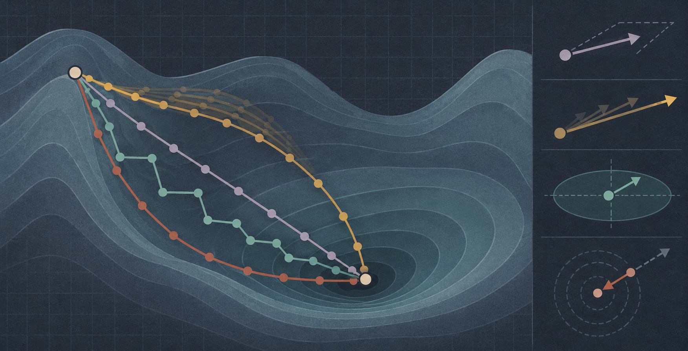
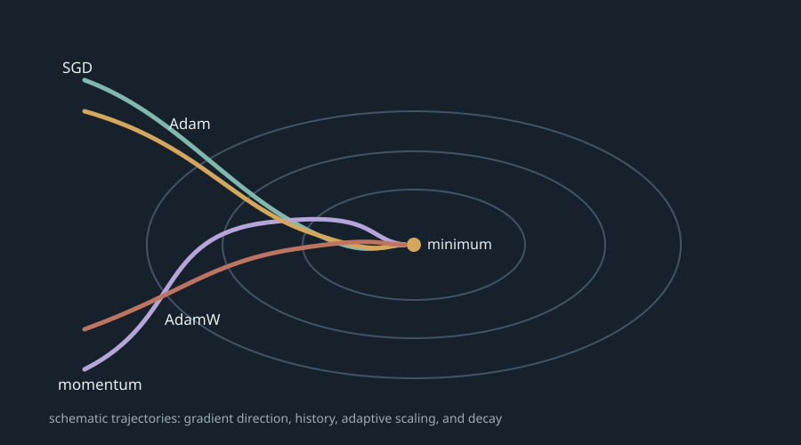
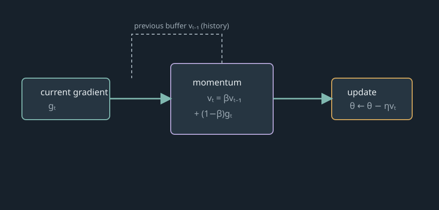
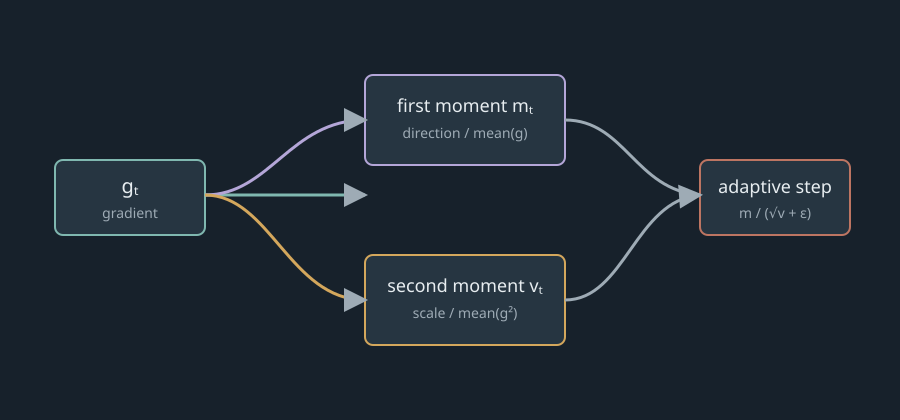
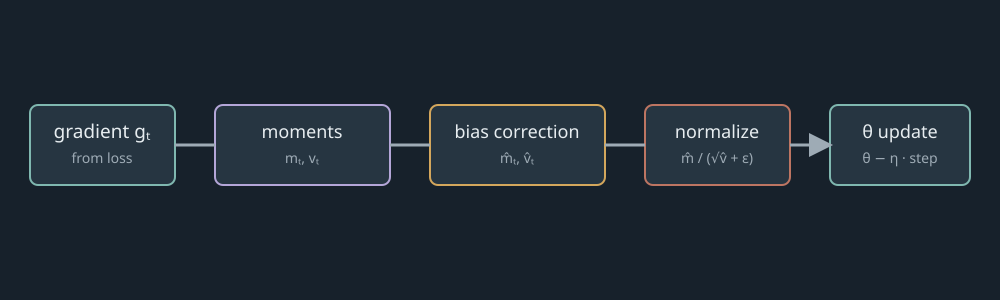
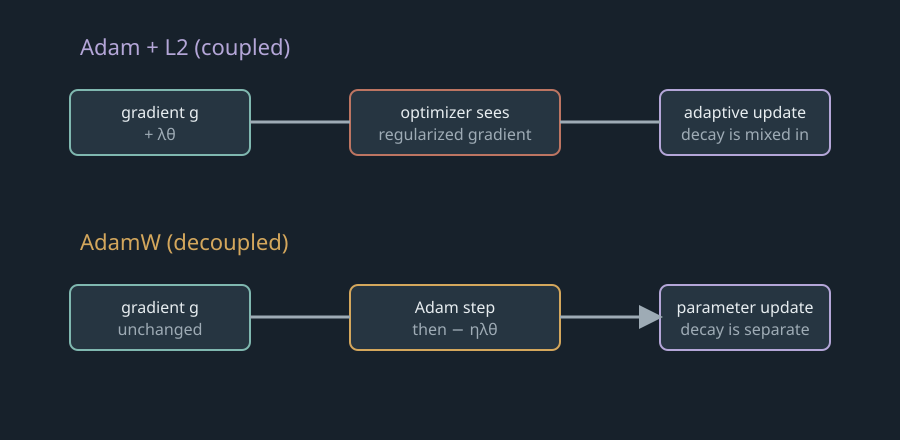
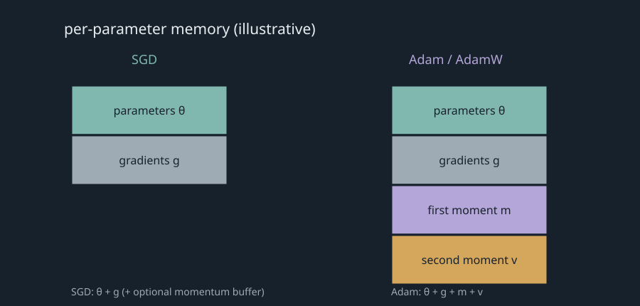

# Module 07 — Optimizers: SGD, Momentum, Adam, and AdamW

**LLM Training Engineering · Optimization fundamentals**



> **The central idea:** the gradient, the optimizer’s internal state, and the actual parameter update are three different things.

An optimizer receives gradients and decides how to update parameters. Different optimizers answer a central question differently:

> **How much should we trust the current gradient compared with what we observed in previous steps?**

This chapter builds that answer from four approaches:

1. SGD uses the current gradient.
2. Momentum remembers a persistent direction.
3. Adam adapts updates using first and second moments.
4. AdamW separates weight decay from the adaptive gradient update.

The runnable experiments are in [`notebooks/07-optimizers.ipynb`](../notebooks/07-optimizers.ipynb).

## 1. What is an optimizer doing?

Imagine a model with one weight:

$$
w=10
$$

After forward and backward passes, suppose the gradient is $g=4$ and the learning rate is $\eta=0.1$. SGD gives:

$$
w_{\text{new}}=w-\eta g=10-0.1(4)=9.6
$$

That is the basic job of an optimizer: turn gradients into parameter updates. The difference between optimizers is how they use current gradients, past gradients, gradient scale, and regularization terms.

## 2. SGD uses the current gradient

SGD without momentum is:

$$
w_{t+1}=w_t-\eta g_t
$$

It has no memory of previous gradients. If one parameter receives:

$$
[4,4,4,-4,4]
$$

across five steps with learning rate `0.1`, the updates are:

| Step | Gradient | Update |
| ---: | ---: | ---: |
| 1 | 4 | −0.4 |
| 2 | 4 | −0.4 |
| 3 | 4 | −0.4 |
| 4 | −4 | +0.4 |
| 5 | 4 | −0.4 |

Every step uses only the latest gradient.



In a narrow loss valley, the useful direction may remain consistent while a sideways direction changes sign. SGD can zigzag and spend updates moving across the valley instead of along it.

SGD can still work very well with a good learning-rate schedule. Its simplicity is useful for baselines and for understanding what more complex optimizers add.

## 3. Momentum remembers recent gradients

Momentum maintains a running direction:

$$
v_t=\beta v_{t-1}+g_t
$$

$$
w_{t+1}=w_t-\eta v_t
$$

Here $v_t$ is the momentum buffer and $\beta$ controls how much history is retained.

With $\beta=0.9$, learning rate `0.1`, and three consecutive gradients of `+4`:

| Step | Gradient | Momentum buffer | Update |
| ---: | ---: | ---: | ---: |
| 1 | 4 | 4.00 | −0.400 |
| 2 | 4 | 7.60 | −0.760 |
| 3 | 4 | 10.84 | −1.084 |

The optimizer becomes more confident in the persistent direction. If the gradient reverses, the buffer does not reverse immediately:



```python
def momentum_updates(
    gradients,
    learning_rate=0.1,
    beta=0.9,
):
    buffer = 0.0
    rows = []

    for step, gradient in enumerate(gradients, start=1):
        buffer = beta * buffer + gradient
        update = -learning_rate * buffer
        rows.append({
            "step": step,
            "gradient": gradient,
            "buffer": buffer,
            "update": update,
        })

    return rows


for row in momentum_updates([4, 4, 4, -4, -4, -4]):
    print(row)
```

Momentum can reduce zigzagging, but a large buffer can also cause overshooting when the landscape changes direction.

## 4. Adam maintains two moving averages

Adam combines momentum-like direction tracking with adaptive scaling. It maintains two statistics for every trainable parameter:



- **First moment, $m$:** moving average of gradients; captures recent direction and magnitude.
- **Second moment, $v$:** moving average of squared gradients; captures recent gradient scale.

The four equations are:

### Step 1 — First moment

$$
m_t=\beta_1m_{t-1}+(1-\beta_1)g_t
$$

### Step 2 — Second moment

$$
v_t=\beta_2v_{t-1}+(1-\beta_2)g_t^2
$$

### Step 3 — Bias correction

$$
\hat m_t=\frac{m_t}{1-\beta_1^t},\qquad
\hat v_t=\frac{v_t}{1-\beta_2^t}
$$

### Step 4 — Parameter update

$$
w_{t+1}=w_t-\eta\frac{\hat m_t}{\sqrt{\hat v_t}+\epsilon}
$$

Everything is elementwise for tensors.

Common defaults are:

| Hyperparameter | Typical value |
| --- | ---: |
| $\beta_1$ | 0.9 |
| $\beta_2$ | 0.999 |
| $\epsilon$ | $10^{-8}$ |
| Learning rate | Task-dependent |



## 5. If numerator and denominator cancel, why does Adam work?

Suppose the first gradient is 10. After bias correction:

$$
\hat m=10,\qquad\hat v=100
$$

so:

$$
\frac{\hat m}{\sqrt{\hat v}}=\frac{10}{10}=1
$$

On the first step, for a nonzero gradient and negligible $\epsilon$, the normalized factor is approximately the sign of the gradient. But the cancellation does not generally continue once gradient history changes.

Suppose:

$$
g_1=2,\qquad g_2=2,\qquad g_3=20
$$

Using $\beta_1=0.9$ and $\beta_2=0.999$ gives an illustrative pattern:

| Step | Gradient | Bias-corrected $m$ | Bias-corrected $\sqrt{v}$ | Ratio |
| ---: | ---: | ---: | ---: | ---: |
| 1 | 2 | 2.00 | 2.00 | 1.00 |
| 2 | 2 | 2.00 | 2.00 | 1.00 |
| 3 | 20 | 8.64 | 11.60 | 0.74 |

The current gradient is 10 times larger, but the normalized update factor is not 10 times larger because Adam remembers the earlier scale.

For alternating gradients:

$$
[+10,-10,+10,-10]
$$

the first moment can partially cancel while the second moment remains positive. The numerator becomes smaller while the denominator remains substantial.

> **Mental model:** $m$ asks “which direction have gradients generally pointed?” and $\sqrt v$ asks “how large have they generally been?”

## 6. Adam simulator

The following simulator compares SGD and Adam for several gradient sequences.

```python
import math


def simulate_adam(
    gradients,
    learning_rate=0.1,
    beta1=0.9,
    beta2=0.999,
    epsilon=1e-8,
):
    first_moment = 0.0
    second_moment = 0.0
    rows = []

    for step, gradient in enumerate(gradients, start=1):
        first_moment = beta1 * first_moment + (1 - beta1) * gradient
        second_moment = beta2 * second_moment + (1 - beta2) * gradient**2

        corrected_m = first_moment / (1 - beta1**step)
        corrected_v = second_moment / (1 - beta2**step)
        ratio = corrected_m / (math.sqrt(corrected_v) + epsilon)

        rows.append({
            "step": step,
            "gradient": gradient,
            "sgd_update": -learning_rate * gradient,
            "adam_update": -learning_rate * ratio,
            "ratio": ratio,
        })

    return rows


sequences = {
    "constant": [1, 1, 1, 1, 1, 1],
    "spike": [1, 2, 4, 8, 16, 32],
    "alternating": [10, -10, 10, -10, 10, -10],
    "increasing": [1, 2, 4, 8, 16, 32],
}

for name, gradients in sequences.items():
    rows = simulate_adam(gradients)
    print(name)
    for row in rows:
        print(row)
```

For the increasing sequence `[1, 2, 4, 8, 16, 32]`, SGD updates grow directly with the gradient while Adam’s normalized updates change more gradually. Adam is not guaranteed to suppress every spike, and its update can occasionally exceed the learning rate depending on history and $\epsilon$.

## 7. Why bias correction matters

Moving averages start at zero. If the gradient is always 10 and $\beta_1=0.9$:

$$
m_1=0.9(0)+0.1(10)=1
$$

The observed gradient is 10, but the raw moving average is only 1. Bias correction gives:

$$
\hat m_1=\frac{1}{1-0.9}=10
$$

For the second moment with $\beta_2=0.999$:

$$
v_1=0.001(10^2)=0.1
$$

$$
\hat v_1=\frac{0.1}{1-0.999}=100
$$

Bias correction makes early estimates more representative of the gradients observed so far.

## 8. Adam versus AdamW

Adam and AdamW share the adaptive-gradient mechanism. Their important difference is how weight decay is applied.

### Adam with an L2 penalty

An L2 penalty adds to the task loss:

$$
L_{\text{total}}=L_{\text{task}}+\frac{\lambda}{2}\|w\|^2
$$

so the gradient becomes:

$$
g_{\text{total}}=g_{\text{task}}+\lambda w
$$

The combined gradient enters Adam’s moment estimates.

### AdamW with decoupled weight decay

AdamW separates the operations:

$$
w_{t+1}=(1-\eta\lambda)w_t-\eta\frac{\hat m_t}{\sqrt{\hat v_t}+\epsilon}
$$

The moments use the task gradient, while weight decay is applied separately.



Suppose weight = 10, learning rate = 0.1, weight decay = 0.1, and task gradient = 0. For AdamW, ignoring historical gradient contribution:

$$
w_{\text{new}}=10(1-0.1\times0.1)=9.9
$$

An L2 penalty on the first Adam step can produce a similar number in this special case, but the optimizers are not equivalent across parameters with different gradient histories.

In PyTorch, inspect the configured optimizer rather than assuming the optimizer name alone describes every decay behavior.

## 9. Compare four optimizers on the same task

Use the same model initialization, batches, and learning rate so the comparison isolates optimizer behavior.

```python
import matplotlib.pyplot as plt
import torch
import torch.nn as nn
import torch.nn.functional as F

torch.manual_seed(42)
device = torch.device("cuda" if torch.cuda.is_available() else "cpu")


class TinyModel(nn.Module):
    def __init__(self):
        super().__init__()
        self.net = nn.Sequential(
            nn.Linear(2, 32),
            nn.Tanh(),
            nn.Linear(32, 1),
        )

    def forward(self, inputs):
        return self.net(inputs)


x = torch.randn(256, 2, device=device)
y = 3 * x[:, 0:1] - 2 * x[:, 1:2]

reference_model = TinyModel().to(device)
initial_weights = reference_model.state_dict()


def run_optimizer(name, lr=0.01, steps=200):
    model = TinyModel().to(device)
    model.load_state_dict(initial_weights)

    if name == "SGD":
        optimizer = torch.optim.SGD(model.parameters(), lr=lr)
    elif name == "Momentum":
        optimizer = torch.optim.SGD(
            model.parameters(),
            lr=lr,
            momentum=0.9,
        )
    elif name == "Adam":
        optimizer = torch.optim.Adam(
            model.parameters(),
            lr=lr,
            weight_decay=0.0,
        )
    elif name == "AdamW":
        optimizer = torch.optim.AdamW(
            model.parameters(),
            lr=lr,
            weight_decay=0.0,
        )
    else:
        raise ValueError(f"Unknown optimizer: {name}")

    losses = []
    for _ in range(steps):
        optimizer.zero_grad(set_to_none=True)
        prediction = model(x)
        loss = F.mse_loss(prediction, y)
        loss.backward()
        optimizer.step()
        losses.append(loss.item())

    return model, optimizer, losses


results = {}
for name in ("SGD", "Momentum", "Adam", "AdamW"):
    results[name] = run_optimizer(name)

plt.figure(figsize=(9, 5))
for name, (_, _, losses) in results.items():
    plt.plot(losses, label=name)

plt.yscale("log")
plt.xlabel("Optimizer step")
plt.ylabel("Training MSE")
plt.title("Same model, same learning rate, different optimizers")
plt.legend()
plt.grid(alpha=0.25)
plt.show()
```

Expected qualitative behavior:

- SGD may progress more slowly because it uses only the current gradient.
- Momentum can accelerate persistent directions.
- Adam may make faster initial progress through adaptive scaling.
- AdamW should closely match Adam here because weight decay is disabled.

Equal learning rates do not mean equal effective update sizes. A fair optimizer comparison tunes each optimizer separately across multiple seeds and evaluates held-out data.

## 10. Inspect optimizer state and memory

Adam and AdamW store extra tensors for moment estimates:



```python
model, optimizer, _ = run_optimizer("AdamW", lr=1e-3, steps=1)
first_parameter = next(model.parameters())
state = optimizer.state[first_parameter]

print("Parameter shape:", tuple(first_parameter.shape))
for key, value in state.items():
    if torch.is_tensor(value):
        print(key, tuple(value.shape))
    else:
        print(key, value)
```

Typical AdamW state includes:

```text
step        scalar
exp_avg     same shape as the parameter
exp_avg_sq  same shape as the parameter
```

For an FP32 parameter tensor containing 64 values:

- weights require 256 bytes;
- first moments require another 256 bytes;
- second moments require another 256 bytes.

That is already 768 bytes across those three tensors, before gradients, temporary activations, and other allocations. For billions of parameters, optimizer state is a major memory consideration.

## 11. Choosing an optimizer

| Optimizer | Strengths | Limitations | Common use |
| --- | --- | --- | --- |
| SGD | Simple and low state memory | Sensitive to learning rate and geometry | Baselines and some vision tasks |
| SGD + momentum | Accelerates persistent directions | Requires tuning and may overshoot | Conventional deep learning |
| Adam | Adaptive per-parameter updates | Extra state; coupled regularization needs care | General neural-network tasks |
| AdamW | Adaptive updates with decoupled weight decay | Extra state and hyperparameters | Common Transformer default |

For a small GPT-style model, AdamW is a reasonable starting point with a tested learning-rate schedule. It is not automatically best: optimizer choice depends on architecture, compute, data, and training budget.

An illustrative configuration is:

```python
optimizer = torch.optim.AdamW(
    model.parameters(),
    lr=3e-4,
    betas=(0.9, 0.95),
    eps=1e-8,
    weight_decay=0.1,
)
```

These are example settings, not universal recommendations. Parameter groups often exclude biases and normalization parameters from weight decay; treat that as an architecture and recipe decision.

## Common mistakes

### Mistake 1 — Treating the gradient as the update

With SGD, gradient and update are directly proportional. With AdamW, they are not. Measure actual parameter changes when diagnosing instability.

### Mistake 2 — Assuming Adam always moves exactly one learning-rate unit

The normalized factor depends on history, changing signs, gradient magnitudes, and $\epsilon$. It is not a hard bound.

### Mistake 3 — Assuming AdamW chooses a good learning rate automatically

AdamW adapts updates across parameters. It does not eliminate learning-rate tuning, warmup, decay schedules, or clipping.

## Final mental model

1. **SGD:** uses the current gradient.
2. **Momentum:** remembers recent gradients and builds a persistent direction.
3. **Adam:** tracks a gradient average and a squared-gradient average to adapt updates.
4. **AdamW:** uses Adam’s adaptive mechanism while applying weight decay separately.

## Quick knowledge check

1. Why does momentum remember previous gradients?
   - To make gradients exactly zero
   - To build a persistent update direction and reduce zigzagging
   - To eliminate learning-rate tuning

2. Why does Adam maintain both $m$ and $v$?
   - $m$ tracks direction/history; $v$ tracks squared-gradient scale
   - $m$ stores weights; $v$ stores the learning rate
   - Both store identical information

3. If the first Adam gradient is +100, what is its normalized update factor approximately?
   - 100
   - 0
   - 1

4. What defines AdamW’s difference from Adam with coupled L2 regularization?
   - AdamW does not use gradients
   - AdamW separates weight decay from adaptive moment calculations
   - AdamW does not use moving averages

<details>
<summary>Reveal the answers</summary>

1. To build a persistent update direction and reduce zigzagging.
2. $m$ tracks direction/history; $v$ tracks squared-gradient scale.
3. Approximately 1.
4. AdamW separates weight decay from adaptive moment calculations.

</details>
