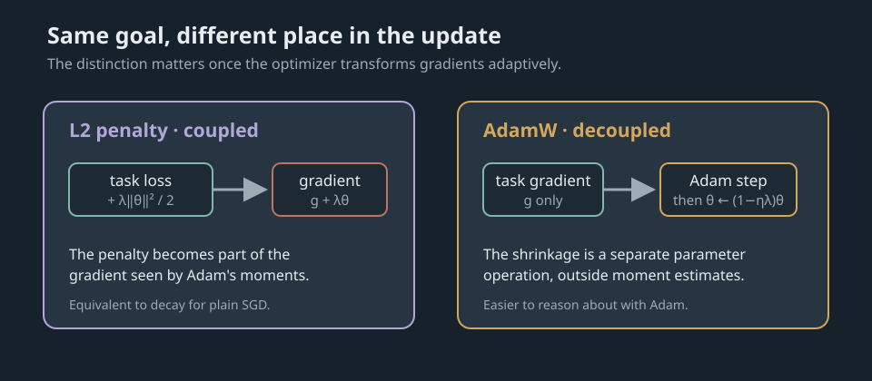
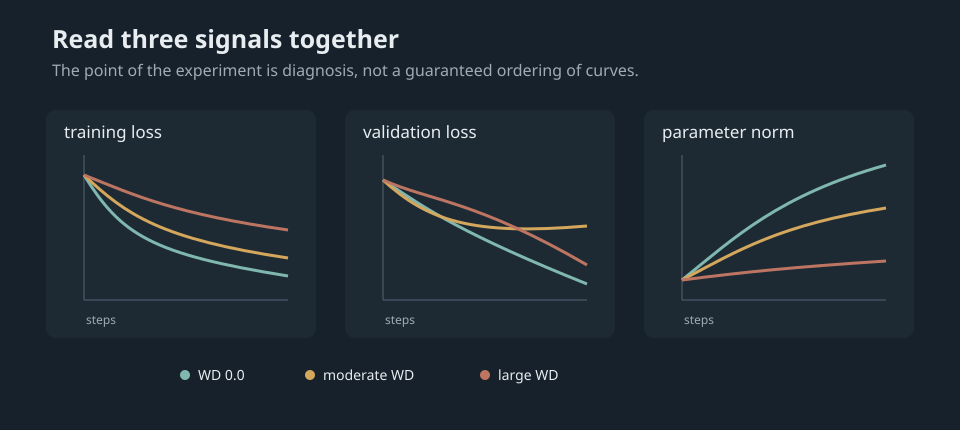
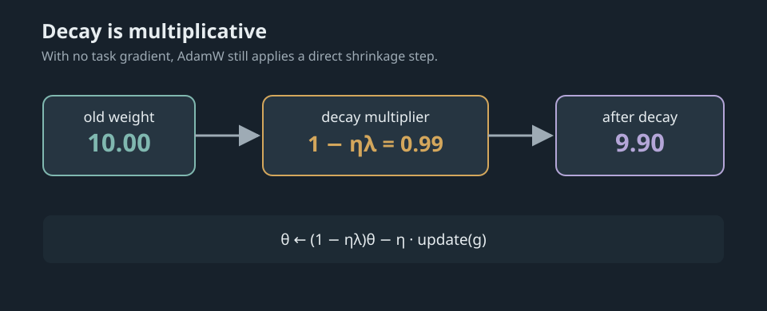
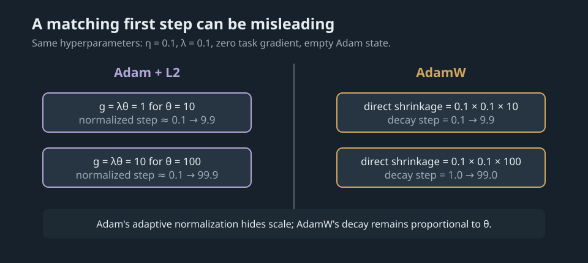
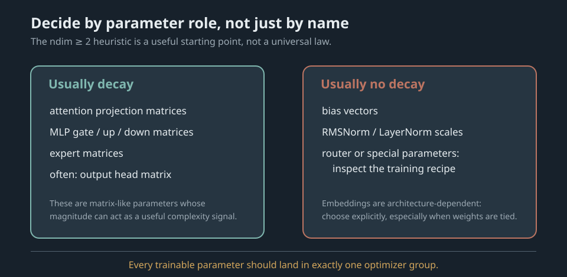
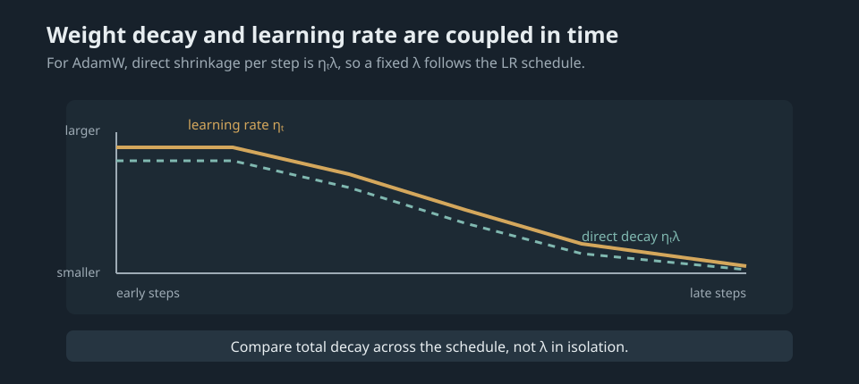

# Module 08 — Weight Decay vs L2 Regularization

**LLM training engineering · regularization and optimizer policy**



> **The central idea:** L2 regularization changes the gradient that an optimizer sees; decoupled weight decay changes the parameters in a separate step.

Weight decay is often introduced with one line of PyTorch:

```python
optimizer = torch.optim.AdamW(
    model.parameters(),
    lr=3e-4,
    weight_decay=0.1,
)
```

That line raises several engineering questions:

- Why does shrinking parameters sometimes help generalization?
- When are L2 regularization and weight decay equivalent?
- Why is AdamW usually preferred to adding an L2 term to the loss?
- Which parameters should be decayed?
- How should the learning-rate schedule affect the choice?

This chapter answers those questions with scalar updates, parameter groups, and a controlled regression experiment. The runnable version is in [`notebooks/08-weight-decay-vs-l2-regularization.ipynb`](../notebooks/08-weight-decay-vs-l2-regularization.ipynb).

## 1. What problem is regularization trying to solve?

Suppose a model predicts product prices from a small, noisy dataset. One model learns a smooth relationship. Another memorizes peculiarities of the training examples. Both can have low training loss, but the memorizing model may perform poorly on new products.

Regularization changes the optimization problem so that, among solutions that fit the data similarly well, solutions with unnecessarily large parameters become less attractive. Smaller parameter magnitudes can be useful, but they are not a guarantee of better generalization: architecture, data, optimization, and parameterization still matter.



> **Pause and predict:** if weight decay lowers the parameter norm but raises both training and validation loss, is that healthy regularization or underfitting?

## 2. Decoupled weight decay: one scalar step

Start with the simplest case: one parameter, no task gradient, and a direct decay operation.

Let:

$$
w=10,\qquad \eta=0.1,\qquad \lambda=0.1,\qquad g_{\text{task}}=0.
$$

AdamW applies the multiplicative decay factor:

$$
w_{t+1}=(1-\eta\lambda)w_t-\eta\,u_t,
$$

where $u_t$ is the optimizer's gradient-driven update. With $u_t=0$:

$$
w_{t+1}=(1-0.1\times0.1)10=9.9.
$$



After ten decay-only steps:

$$
w_{10}=10(1-0.01)^{10}\approx9.044.
$$

The direct shrinkage fraction per step is $\eta\lambda$, not $\lambda$ by itself. If the learning rate changes, the amount of direct decay per step changes too.

## 3. The task gradient still has a vote

Weight decay does not force every parameter to become smaller after every step. It adds a shrinking tendency while the task gradient remains free to move the parameter in a useful direction.

For decoupled decay, the scalar update is:

$$
w_{t+1}=(1-\eta\lambda)w_t-\eta\,u_t.
$$

Take:

$$
w_t=10,\qquad u_t=-4,\qquad \eta=0.1,\qquad \lambda=0.1.
$$

Then:

| Influence | Change |
| --- | ---: |
| decay | $-0.1$ |
| task update $-\eta u_t$ | $+0.4$ |
| total | $+0.3$ |

So:

$$
w_{t+1}=9.9-0.1(-4)=10.3.
$$

The weight grew because the task update was larger than the decay. The useful mental model is **two forces in one transition**, not “all weights shrink every step.”

## 4. L2 regularization and decoupled decay

### L2 regularization couples the penalty to the gradient

With L2 regularization, add a parameter penalty to the task loss:

$$
L_{\text{total}}=L_{\text{task}}+\frac{\lambda}{2}\sum_i w_i^2.
$$

The gradient becomes:

$$
g_{\text{total}}=g_{\text{task}}+\lambda w.
$$

The optimizer receives one combined gradient. With vanilla SGD:

$$
w_{t+1}=w_t-\eta(g_{\text{task}}+\lambda w_t)
       =(1-\eta\lambda)w_t-\eta g_{\text{task}}.
$$

That is algebraically the same update as decoupled weight decay for plain SGD, when the coefficients are matched.

### Adam breaks the equivalence

Adam transforms the gradient using moving averages:

$$
m_t=\beta_1m_{t-1}+(1-\beta_1)g_t,
$$

$$
v_t=\beta_2v_{t-1}+(1-\beta_2)g_t^2.
$$

If $\lambda w$ is inserted into $g_t$, it also enters both moment estimates. Adam's adaptive normalization can therefore change the effective influence of the regularization term.

AdamW keeps the task gradient in the moment estimates and applies the shrinkage separately:

$$
w_{t+1}=(1-\eta\lambda)w_t-\eta\,\operatorname{AdamUpdate}(g_{\text{task}}).
$$


| Feature | Adam + L2 penalty | AdamW |
| --- | --- | --- |
| Adds regularization to task gradient | Yes | No |
| Regularization enters moment estimates | Yes | No, not directly |
| Applies separate parameter shrinkage | No | Yes |
| Behavior depends on adaptive history | Yes | The task update does; decay remains explicit |
| Common starting point for LLM training | Less common | Common |

## 5. A first-step comparison

A small numerical example shows why a single matching result does not prove equivalence.

Assume positive weights, zero task gradient, learning rate $0.1$, decay coefficient $0.1$, empty Adam state, and negligible $\epsilon$.



| Initial weight | Adam + L2, approximately | AdamW |
| ---: | ---: | ---: |
| 1 | 0.9 | 0.99 |
| 10 | 9.9 | 9.9 |
| 100 | 99.9 | 99.0 |

For Adam + L2, the first-step L2 gradient is $\lambda w$. Adam normalizes it, so the update is approximately the learning rate for any positive nonzero weight. For AdamW, the direct shrinkage is proportional to the parameter value.

The exact values depend on the optimizer implementation, bias correction, and $\epsilon$. The lesson is more important than the rounded table: **adaptive normalization and direct decay do not have the same scale behavior.**

## 6. Which parameters should receive decay?

Do not apply weight decay blindly to every trainable tensor. A common Transformer policy is to decay most matrix-like weights and exclude normalization scales and biases.



Normalization scales have a specific role. For RMSNorm:

$$
y=\frac{x}{\operatorname{RMS}(x)}\odot\gamma.
$$

The learned scale $\gamma$ controls the magnitude of an already normalized feature. Pulling it toward zero can interfere with that role, which is why normalization parameters are commonly placed in a no-decay group.

Biases are additive offsets and are usually a small part of the parameter count. Many recipes exclude them because the regularization benefit is limited compared with the main matrix weights.

Embeddings, output heads, routers, and tied weights are recipe-dependent. Make those decisions explicit rather than relying on a name-based guess.

| Parameter kind | Typical starting treatment |
| --- | --- |
| Attention Q/K/V and output matrices | Decay |
| MLP gate, up, and down matrices | Decay |
| Expert matrices | Usually decay |
| RMSNorm / LayerNorm scale | No decay |
| Bias vectors | No decay |
| Token embeddings | Architecture- and recipe-dependent |
| Output head | Recipe-dependent; often decay |
| Router or special parameters | Inspect the specific recipe |

### Build explicit AdamW parameter groups

The simple `ndim >= 2` heuristic is a useful baseline. It puts linear weights and embeddings in the decay group, while one-dimensional scales and biases go to the no-decay group.

```python
import torch
from torch import nn


class TinyTransformerPart(nn.Module):
    def __init__(self):
        super().__init__()
        self.embedding = nn.Embedding(1_000, 128)
        self.q_proj = nn.Linear(128, 128)
        self.k_proj = nn.Linear(128, 128)
        self.norm = nn.LayerNorm(128)
        self.mlp = nn.Sequential(
            nn.Linear(128, 512),
            nn.SiLU(),
            nn.Linear(512, 128),
        )


model = TinyTransformerPart()
decay_params = []
no_decay_params = []

for name, parameter in model.named_parameters():
    if not parameter.requires_grad:
        continue
    if parameter.ndim >= 2:
        decay_params.append(parameter)
        print("DECAY:   ", name, tuple(parameter.shape))
    else:
        no_decay_params.append(parameter)
        print("NO DECAY:", name, tuple(parameter.shape))

optimizer = torch.optim.AdamW(
    [
        {"params": decay_params, "weight_decay": 0.1},
        {"params": no_decay_params, "weight_decay": 0.0},
    ],
    lr=3e-4,
    betas=(0.9, 0.95),
)
```

If the recipe excludes embeddings, identify embedding parameters by object identity and put them in the no-decay group. This also makes tied weights explicit:

```python
def make_param_groups(model, weight_decay=0.1, decay_embeddings=False):
    embedding_ids = {
        id(module.weight)
        for module in model.modules()
        if isinstance(module, nn.Embedding)
    }
    decay = []
    no_decay = []

    for parameter in model.parameters():
        if not parameter.requires_grad:
            continue
        is_embedding = id(parameter) in embedding_ids
        if parameter.ndim < 2 or (is_embedding and not decay_embeddings):
            no_decay.append(parameter)
        else:
            decay.append(parameter)

    return [
        {"params": decay, "weight_decay": weight_decay},
        {"params": no_decay, "weight_decay": 0.0},
    ]
```

Every trainable parameter must appear in exactly one optimizer group. For a complicated architecture, extend this policy with explicit rules for routers, output heads, and tied parameters.

## 7. Controlled experiment: fit noisy data

The following experiment compares `weight_decay` values on a small noisy training set and a clean held-out grid. It records three signals:

1. training loss — how well the model fits the noisy examples;
2. validation loss — how well it recovers the underlying function;
3. parameter norm — how strongly the parameters are being constrained.

Start every run from the same initial weights. Otherwise, differences between curves can come from initialization rather than weight decay.

```python
import copy
import matplotlib.pyplot as plt
import torch
from torch import nn


torch.manual_seed(42)
device = torch.device("cuda" if torch.cuda.is_available() else "cpu")


def true_fn(x):
    return torch.sin(3 * x)


x_train = torch.linspace(-1, 1, 24).unsqueeze(1)
y_train = true_fn(x_train) + 0.25 * torch.randn_like(x_train)
x_val = torch.linspace(-1, 1, 200).unsqueeze(1)
y_val = true_fn(x_val)
x_train, y_train = x_train.to(device), y_train.to(device)
x_val, y_val = x_val.to(device), y_val.to(device)


class MLP(nn.Module):
    def __init__(self):
        super().__init__()
        self.net = nn.Sequential(
            nn.Linear(1, 128),
            nn.Tanh(),
            nn.Linear(128, 128),
            nn.Tanh(),
            nn.Linear(128, 1),
        )

    def forward(self, x):
        return self.net(x)


template = MLP().to(device)
initial_state = copy.deepcopy(template.state_dict())


def parameter_norm(model):
    return torch.sqrt(
        sum(parameter.float().square().sum() for parameter in model.parameters())
    ).item()


def train_experiment(weight_decay, steps=400):
    model = MLP().to(device)
    model.load_state_dict(initial_state)
    optimizer = torch.optim.AdamW(
        model.parameters(), lr=1e-3, weight_decay=weight_decay
    )
    history = {"train": [], "validation": [], "weight_norm": []}

    for step in range(steps):
        model.train()
        optimizer.zero_grad(set_to_none=True)
        train_loss = nn.functional.mse_loss(model(x_train), y_train)
        train_loss.backward()
        optimizer.step()

        if step % 10 == 0 or step == steps - 1:
            model.eval()
            with torch.no_grad():
                validation_loss = nn.functional.mse_loss(
                    model(x_val), y_val
                ).item()
            history["train"].append(train_loss.item())
            history["validation"].append(validation_loss)
            history["weight_norm"].append(parameter_norm(model))

    return model, history


results = {decay: train_experiment(decay) for decay in (0.0, 0.1, 1.0)}

fig, axes = plt.subplots(1, 3, figsize=(15, 4))
for decay, (_, history) in results.items():
    label = f"WD={decay}"
    axes[0].plot(history["train"], label=label)
    axes[1].plot(history["validation"], label=label)
    axes[2].plot(history["weight_norm"], label=label)

for axis, title in zip(
    axes, ["Training loss", "Validation loss", "Parameter norm"]
):
    axis.set_title(title)
    axis.set_xlabel("logging point (10 steps)")
    axis.grid(True, alpha=0.25)
    axis.legend()

plt.tight_layout()
plt.show()
```

### How to interpret it

Ask these questions rather than expecting one fixed curve:

- Does stronger decay reduce the parameter norm?
- Does training loss become higher because the model is constrained?
- Does validation loss improve before excessive decay causes underfitting?
- Are the comparisons fair because every run uses the same initial state and data?

The clean validation targets in this toy setup measure recovery of the underlying function, not a realistic production split. Repeat across several seeds before drawing a strong conclusion.

## 8. Weight decay follows the learning-rate schedule

With fixed $\lambda$, AdamW's direct decay fraction at step $t$ is:

$$
\text{decay fraction}_t=\eta_t\lambda.
$$

For $\lambda=0.1$:

| Learning rate | Direct decay fraction per step |
| ---: | ---: |
| $10^{-3}$ | $10^{-4}$ = 0.01% |
| $10^{-4}$ | $10^{-5}$ = 0.001% |



The total effect depends on the entire schedule and the number of optimizer steps. Two runs with the same `weight_decay=0.1` can therefore experience different cumulative shrinkage if their learning rates differ.

This is distinct from learning-rate decay:

| | Weight decay | Learning-rate decay |
| --- | --- | --- |
| What changes? | Parameter values are shrunk | The optimizer step size becomes smaller |
| Primary purpose | Regularization | Control optimization progress |
| Typical setting | `weight_decay=0.1` | scheduler or LR function |
| Can affect generalization? | Directly, sometimes | Indirectly, through optimization |
| Applied where? | Optimizer parameter update | Learning-rate value used by update |

## 9. Practical guidance and failure modes

Weight decay is regularization, not a general emergency fix.

| Observation | First response |
| --- | --- |
| Training loss low, validation loss high | Try regularization, data improvements, or capacity changes |
| Training and validation losses both high | Investigate optimization, data, or model capacity first |
| Loss suddenly becomes `NaN` | Debug numerical stability; do not automatically raise decay |
| Model memorizes a tiny dataset | Try a measured decay sweep alongside data improvements |
| Model underfits | Reduce excessive decay or increase useful capacity |
| Norm grows rapidly | Inspect gradients, learning rate, parameter groups, and update scale |
| Large Transformer training | Start from a tested architecture-specific recipe |

Common mistakes:

1. **Confusing `weight_decay=0.1` with 10% shrinkage per step.** The direct fraction is $\eta\lambda$.
2. **Adding an L2 term to the loss and also using AdamW decay unintentionally.** That combines two regularization paths.
3. **Decaying normalization scales and biases without a reason.** Use explicit groups.
4. **Changing initialization between experiments.** Controlled comparisons need the same starting state.
5. **Using parameter norm as a quality metric by itself.** A smaller norm is not automatically better.
6. **Forgetting tied parameters.** A shared tensor must belong to only one optimizer group.

## 10. Knowledge check

<details>
<summary>1. AdamW uses learning rate 0.001 and weight decay 0.1. What fraction is directly decayed per step?</summary>

The direct fraction is $\eta\lambda=0.001\times0.1=0.0001$, or **0.01%**.
</details>

<details>
<summary>2. Why can AdamW differ from Adam with an L2 penalty?</summary>

With L2, $\lambda\theta$ enters the gradient and therefore Adam's moment estimates. AdamW applies parameter shrinkage separately from the adaptive gradient update.
</details>

<details>
<summary>3. Which parameter is commonly excluded from decay?</summary>

An RMSNorm or LayerNorm scale, and usually a bias vector, commonly belong in the no-decay group.
</details>

<details>
<summary>4. What should you consider when validation loss worsens while training loss keeps falling?</summary>

Consider regularization strength, data quality, model capacity, and possible overfitting. Do not change the learning rate blindly.
</details>

## Final mental model

1. **L2 regularization adds $\lambda\theta$ to the gradient.**
2. **Decoupled weight decay multiplies parameters by $(1-\eta\lambda)$.**
3. **The two are equivalent for vanilla SGD with matching coefficients, but generally differ with adaptive optimizers.**
4. **AdamW keeps decay out of Adam's moment estimates.**
5. **Use explicit parameter groups and treat embeddings, routers, and tied weights as recipe decisions.**
6. **Judge a decay experiment with loss, validation behavior, norms, and controlled initialization together.**
